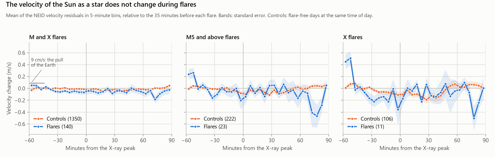

# FLINCH

[](https://github.com/gabgarar/FLINCH/actions/workflows/tests.yml)
[](https://gabgarar.github.io/FLINCH/)
[](https://www.python.org/)
[](LICENSE)

**FL**are-**IN**duced **CH**anges in Sun-as-a-star radial velocities.

*Do solar flares contaminate the radial-velocity detection of Earth analogues?*

**Documentation: <https://gabgarar.github.io/FLINCH/>**

Spectrographs built to find exoplanets measure the velocity of a star to a few tens of
centimetres per second. One of them, NEID (Kitt Peak, Arizona), also observes the Sun every
clear day as if it were a distant star, one spectrum every 83 seconds. FLINCH cross-matches
those spectra with the flares recorded by the GOES satellites and measures what a flare does
to the disc-integrated velocity and spectrum: whether it is detectable, from which flare
size, and what that implies for planet searches around other Sun-like stars.

## Results so far

Work in progress (November 2026). The velocity analysis is complete; the spectral one rests
on 12 flares and nine control windows.

| Question | Answer |
|---|---|
| Does the velocity change during a flare? | No. NEID: −0.035 ± 0.035 m/s for 139 M and X flares against their own controls. HARPS-N, which saw other flares: −0.021 ± 0.039 m/s for 115. Together, below 0.07 m/s (95 %), less than the signal of the Earth |
| Is there a rotation signature? | No: −0.01 ± 0.04 m/s per X1 flare at the limb with the two instruments, within a factor of 1.5 to 3 of the largest shift expected |
| Do flares excite the five-minute oscillations? | No, within 8 % in amplitude |
| Do the same spectra see the flares? | Yes: Ca II H and K rise in all 8 X flares on the disc with usable spectra (+5.3 ± 1.7 parts per thousand on average), against no change in 9 control windows |



## Data

Both sources are public and need no registration.

| Data | Source |
|---|---|
| Flare list, positions and one-minute fluxes | GOES-16 and GOES-18 XRS science-quality products, NOAA/NCEI |
| Solar radial velocities and spectra | NEID solar archive, NExScI |
| Solar radial velocities of a second instrument | HARPS-N solar data release (Dumusque et al. 2026), DACE |

## Quick start

```
python -m venv venv
venv/Scripts/python -m pip install -e ".[analysis,dev]"
python -m flinch download     # flare lists and velocity table, 22 MB, into data/
python -m flinch coverage     # which flares NEID observed
python -m flinch pilot        # velocity response against controls
python -m flinch robustness   # the same under other analysis choices
python -m flinch replication  # the same measurement with NEID and with HARPS-N (downloads 64 MB)
python -m pytest              # tests, no network needed
```

The distribution is called `flinch-rv` (the name `flinch` is taken on PyPI); the import name
is `flinch`.

## Layout

| Path | Content |
|---|---|
| `flinch/` | The package: data access, quality cuts, epoch analysis, spectra |
| `tests/` | Unit tests |
| `results/` | Derived tables |
| `docs/web/` | The documentation site and its figures |
| `docs/plan.md`, `docs/resultados.md` | Working documents, in Spanish |

## Cite

If you use FLINCH in academic work, please cite the software:

> García, G. (2026). *FLINCH: FLare-INduced CHanges in Sun-as-a-star radial velocities* (v0.1.0).
> <https://github.com/gabgarar/FLINCH>

GitHub shows a ready-made citation under "Cite this repository", generated from
[CITATION.cff](CITATION.cff). A paper is in preparation.

## Licence

BSD 3-Clause, see [LICENSE](LICENSE).
