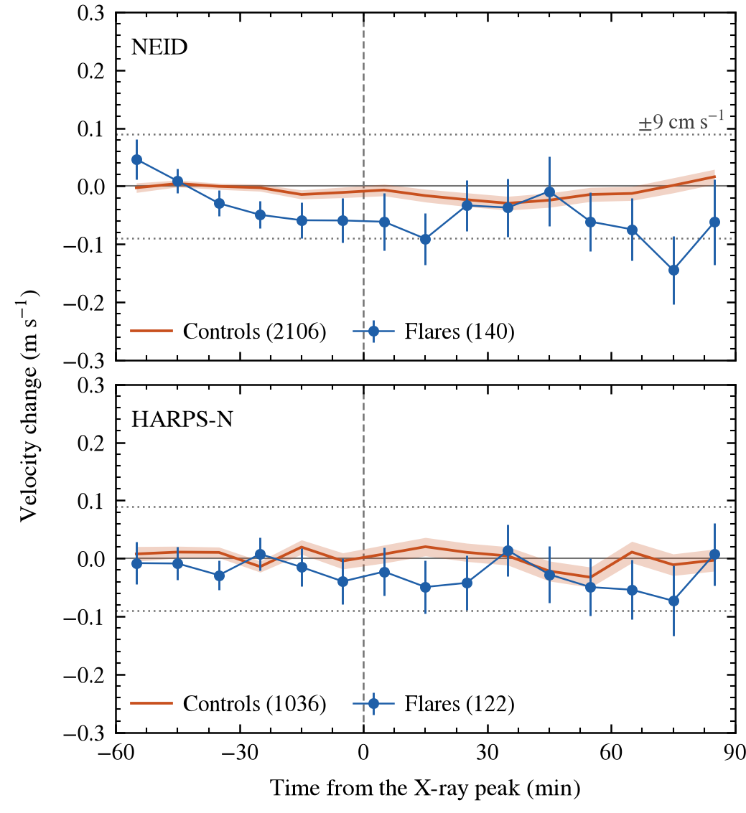

# FLINCH: resultados

Estado a 20 de noviembre de 2026. La sección 1 se reproduce con `python -m flinch
replication`, las secciones 2 y 3 con `python -m flinch robustness` y `python -m flinch pilot`;
las tablas quedan en `results/` y las figuras en `docs/web/img/`. La sección 4 se apoya en 12
fulguraciones y 9 ventanas de control de NEID.

## 1. La velocidad del Sol no cambia durante las fulguraciones

Dos instrumentos que observaron fulguraciones distintas dan la misma respuesta: la velocidad
radial del Sol visto como estrella no cambia durante una fulguración.

Cada fulguración se compara con sus propios controles (misma hora, otros días, sin
fulguraciones). Los errores salen de un remuestreo de días enteros, porque las fulguraciones
de un mismo día no son independientes. Cambio de velocidad en m/s:

| Fulguraciones | NEID | HARPS-N | Ambos | Cota al 95 % |
|---|---|---|---|---|
| M y X | −0,035 ± 0,035 (139) | −0,021 ± 0,039 (115) | −0,029 ± 0,026 (254) | 0,07 |
| M1 a M4 | −0,039 ± 0,041 (116) | +0,006 ± 0,044 (97) | −0,018 ± 0,030 (213) | 0,07 |
| M5 a M9 | +0,035 ± 0,086 (12) | −0,206 ± 0,078 (11) | −0,098 ± 0,058 (23) | 0,19 |
| X | −0,060 ± 0,088 (11) | −0,104 ± 0,127 (7) | −0,074 ± 0,072 (18) | 0,19 |
| Desplazamiento por X1 | −0,010 ± 0,061 | −0,005 ± 0,040 | −0,006 ± 0,033 | 0,06 |
| Término de rotación por X1 en el limbo | −0,106 ± 0,082 | +0,022 ± 0,043 | −0,006 ± 0,038 | 0,07 |

Entre paréntesis, el número de fulguraciones. «Ambos» pesa cada instrumento con el inverso
de su varianza; una fulguración está en las dos muestras. Juntos, el cambio medio queda por
debajo de 0,07 m/s, menos que los 0,09 m/s que la Tierra imprime en el Sol.

- **HARPS-N** (La Palma, 9 a 17 UT, exposiciones de 5 minutos, datos públicos de Dumusque et
  al. 2026) observa en el día europeo y NEID en la tarde americana: ven fulguraciones
  distintas. Su serie se analizó después, una sola vez, con las decisiones ya tomadas para NEID.
- **No hay respuestas ocultas de signo variable**: la dispersión de los cambios de las
  fulguraciones (0,40 m/s en NEID, 0,41 en HARPS-N) es igual a la de sus controles.
- **Una fila llama la atención**, la de las 11 fulguraciones M5 a M9 con HARPS-N. Esas
  fulguraciones están menos dispersas de lo habitual (0,29 frente a 0,41 m/s), lo que hace
  pequeño su error: los conjuntos de 11 controles quedan igual de lejos de cero el 10 % de
  las veces, y NEID no repite el valor. En las filas con unas diez fulguraciones el propio
  error es incierto en una cuarta parte.

El término de rotación es el análisis con signo: una mancha brillante en la mitad del disco
que se acerca debería bajar la velocidad y en la que se aleja subirla. El cambio esperado es
ΔRV ≈ (ΔF/F) · v_rot · K, con ΔF/F el aumento relativo de brillo en el visible, v_rot la
rotación proyectada (hasta 1983 m/s) y K un factor entre 0 (la luz añadida es un continuo sin
líneas, que no desplaza las líneas del resto del disco) y 1 (lleva las líneas de la fotosfera
que tiene debajo). La cota equivale a K · ΔF/F < 3,5 × 10⁻⁵ por fulguración X1.

## 2. El resultado no depende de las decisiones de análisis

Con NEID, donde se tomaron las decisiones:

| Variante | Fulguraciones | Cambio medio | Por X1 | Rotación por X1 |
|---|---|---|---|---|
| Por defecto | 139 | −0,035 ± 0,035 | −0,010 ± 0,061 | −0,106 ± 0,082 |
| Polinomio diario de grado 1 | 137 | −0,022 ± 0,036 | −0,015 ± 0,060 | −0,045 ± 0,080 |
| Polinomio diario de grado 3 | 139 | −0,001 ± 0,033 | +0,016 ± 0,049 | −0,079 ± 0,083 |
| Ventana: ±3 min del máximo de la derivada de GOES | 120 | −0,009 ± 0,042 | −0,019 ± 0,061 | −0,108 ± 0,135 |
| Ventana: primeros 10 min desde el inicio | 134 | −0,040 ± 0,035 | +0,006 ± 0,045 | −0,004 ± 0,080 |
| Ventana: ±5 min del máximo en rayos X | 126 | −0,021 ± 0,042 | −0,111 ± 0,085 | −0,134 ± 0,154 |
| Fondo: recta ajustada a ambos lados | 93 | −0,008 ± 0,040 | −0,032 ± 0,070 | −0,002 ± 0,113 |
| Bootstrap por 81 regiones activas en vez de 111 días | 139 | −0,035 ± 0,035 | −0,010 ± 0,061 | −0,106 ± 0,082 |
| Solo clase X | 11 | −0,060 ± 0,088 | +0,011 ± 0,065 | −0,051 ± 0,104 |

Todo en m/s. "Por defecto" es: polinomio de grado 2 por día, ventana desde el inicio hasta
2 minutos después del máximo, línea base en los 35 minutos anteriores al inicio y controles
en otros días. El máximo de la derivada del flujo de GOES marca la fase impulsiva; de
mediana cae 3,5 minutos antes del máximo en rayos X.

Los controles del mismo día (a 2 y 3 horas) solo existen para 8 fulguraciones, porque casi
siempre caen fuera de la jornada de observación o cerca de otra fulguración. No dicen nada:
+0,07 ± 0,17 m/s.

### Sensibilidad demostrada

Una señal falsa añadida a los datos brutos y pasada por toda la cadena:

| Señal inyectada | Recuperada | Probabilidad de detectarla al 95 % |
|---|---|---|
| 5 cm/s | 4,9 cm/s | 40 % |
| 10 cm/s | 9,8 cm/s | 88 % |
| 20 cm/s | 19,5 cm/s | 100 % |
| 50 cm/s | 48,8 cm/s | 100 % |

## 3. Las fulguraciones no aumentan la amplitud de las oscilaciones del Sol

La potencia de las fluctuaciones de velocidad (dominada por las oscilaciones de 5 minutos) es
la misma en los 35 minutos posteriores al máximo que en los 35 anteriores al inicio.

| Magnitud | Fulguraciones | Muestras nulas | Cota al 95 % del exceso |
|---|---|---|---|
| ln(potencia después / antes) | −0,068 | 0,001 ± 0,053 | 0,16 |
| Lo mismo, pesando las frecuencias altas | −0,013 | −0,009 ± 0,060 | 0,10 |

En amplitud, un aumento medio superior al 8 % queda descartado. Es una prueba de la propuesta
de Karoff y Kjeldsen (2008), con la limitación de que la cadencia de 83 s solo llega a 6 mHz.

## 4. Los mismos espectros sí ven las fulguraciones

Esta parte es el apoyo del resultado principal: demuestra que el resultado nulo en velocidad
no se debe a que los espectros no capten las fulguraciones. Que H alfa responda a las
fulguraciones en luz integrada ya se conoce (Otsu et al. 2022; Ma et al. 2024; Pietrow et
al. 2024).

Hay 12 fulguraciones X con espectros utilizables y 9 ventanas de control sin fulguración,
medidas igual. La respuesta es el cambio medio entre 8 minutos antes y 10 después del máximo,
en partes por mil. El error de cada fulguración suma en cuadratura la dispersión de sus
propios espectros previos y la dispersión de los controles, que recoge las derivas lentas.

| Índice | Detectadas a más de 3 sigmas (de 12) | Media en el disco (8) | Media cerca del limbo (4) | Dispersión de los controles (9) |
|---|---|---|---|---|
| Ca II H y K | 7 | +5,3 ± 1,7 | +1,7 ± 0,9 | 0,66 ± 0,16 |
| H alfa, núcleo de 0,6 Å | 4 | +3,3 ± 1,1 | +0,8 ± 0,6 | 0,63 ± 0,16 |
| H beta, núcleo (índice propio) | 3 | +2,2 ± 0,5 | +0,9 ± 0,5 | 0,60 ± 0,15 |
| Ca II 8542 | 3 | +2,2 ± 0,7 | +0,9 ± 0,4 | 0,56 ± 0,14 |
| H alfa, banda de 1,6 Å | 2 | +1,1 ± 0,3 | +0,4 ± 0,2 | 0,32 ± 0,08 |
| Ca I 6573 (referencia fotosférica) | 0 | 0,0 ± 0,2 | +0,2 ± 0,3 | 0,21 ± 0,05 |
| Velocidad radial (m/s) | 0 | −0,11 ± 0,21 | −0,06 ± 0,08 | 0,81 ± 0,20 |

- **Las ocho fulguraciones sobre el disco se abrillantan**, en Ca II H y K y en H alfa. Seis
  superan las 3 sigmas por sí solas en Ca II H y K y cuatro en H alfa. Juntas, su media es de
  +5,3 ± 0,4 y +3,3 ± 0,2 con solo los errores de medida, frente a −0,02 y −0,06 en los
  controles.
- **Ca II H y K es el índice más sensible.** Cerca del limbo la respuesta es débil o nula.
- **La respuesta sigue a la energía y a la posición, no a la clase**: correlación de rangos
  de 0,6 a 0,8 con la fluencia por el escorzo, y negativa con la clase GOES. Con 12 puntos
  es una indicación.
- **La velocidad no sigue a la respuesta cromosférica**: 0,18 ± 0,18 m/s por parte por mil
  de H alfa multiplicada por la rotación. Con el error completo, los −1,4 m/s de la
  fulguración que más responde son 1,5 sigmas.
- **Nueve de las 12 tienen una eyección candidata** en el catálogo de LASCO; las que no,
  también responden.

Con solo el error propio de cada fulguración salían 9 detecciones de 12 en H alfa: era
optimista, porque ese error no incluye las derivas lentas.

La tabla fulguración a fulguración está en `results/spectral_response.csv` y en la web.

## 5. Cómo se ha medido la velocidad

| Paso | Qué se hace |
|---|---|
| Calidad | Se descartan los espectros con error de velocidad no válido, con relación señal/ruido a más del 1 % de su mediana móvil (nubes) o a más de 5 sigmas de la tendencia del día, y los días con dispersión superior a 1,5 m/s. Quedan 233 857 de 366 180. |
| Tendencia diaria | Se resta un polinomio de grado 2 a cada día. La dispersión de un espectro es de 0,81 m/s, casi toda por las oscilaciones solares. |
| Muestra | Entran 140 fulguraciones con ventanas completas antes y durante (139 con al menos tres controles). De las 279 observadas en el pico se pierden 53 por días descartados y 89 por ventanas incompletas, 38 de ellas porque la fulguración empezó al abrir el telescopio. |
| Controles | Para cada fulguración, épocas a la misma hora del día en días cercanos (±15) sin fulguraciones M o X a menos de 45 minutos. |
| Ruido | La dispersión de los controles da 0,39 m/s por fulguración. |
| Oscilaciones de 5 minutos | No se filtran: las ventanas promedian varios espectros y el ruido que dejan está incluido en los controles. |

Los cortes de calidad se eligieron mirando solo el ruido de los controles y el número de
fulguraciones, nunca el resultado. Las opciones de análisis se fijaron después del primer
piloto, no antes; la tabla de la sección 2 muestra que el resultado no depende de ellas.

## 6. Comparación con lo publicado

Leídos completos los artículos más cercanos (20 de noviembre de 2026):

- **Pietrow et al. 2024** siguieron con HARPS-N las fulguraciones X2.2 y X9.3 del 6 de
  septiembre de 2017, con un espectro cada 5 minutos. No detectan cambio de velocidad: fijan
  una cota de 50 cm/s, señalan un pequeño aumento de unas decenas de cm/s y piden un estudio
  estadístico. La cota de aquí para la respuesta media, 9 cm/s, es cinco veces más baja y
  sale de 139 fulguraciones; con HARPS-N, 7 cm/s y 254. La mayor de sus dos fulguraciones está
  en la muestra de HARPS-N: su cambio es de −0,01 m/s, con un error de 0,41 por ser una sola. En Ca II H y K ven más de un 1 %, igual en las dos fulguraciones
  pese a su distinta clase; aquí Ca II H y K también es el índice más sensible (hasta un
  1,7 %) y la respuesta tampoco sigue a la clase.
- **Otsu et al. 2022 y 2024 y Ma et al. 2024** usan espectrógrafos de imagen en H alfa.
  No miden la luz de todo el disco tal cual: integran una región alrededor de la fulguración
  y normalizan por el disco, porque la señal es difícil de ver en la integral completa. NEID
  la registra directamente en la luz de todo el disco, y aquí hay además ventanas de control.
- **Otsu et al. 2026** reúnen 34 fulguraciones, pero miden en imágenes cuándo aparecen los
  bucles posteriores a la fulguración. No es una estadística de la respuesta en luz
  integrada, y dicen que ese estudio está por hacer.
- **La fulguración en común**, la X1.6 del 5 de agosto de 2023 (Otsu et al. 2024), está junto
  al limbo: aquí Ca II y H beta suben entre 1 y 2 partes por mil, 2 sigmas. NEID dejó de
  observar 9 minutos después del máximo, antes del segundo máximo de H alfa que ellos ven a
  los 13 minutos.
- **Brillo esperado en el visible** (Kretzschmar 2011): 7 partes por millón en el máximo de
  una fulguración M2 media y 264 en la X17 del 28 de octubre de 2003. Esas clases están en la
  escala antigua de GOES, que llevaba un factor 0,7; en la escala de aquí son entre 11 y 23
  partes por millón para una X1. Con la rotación solar eso son, como mucho, de 2 a 5 cm/s en
  el limbo. La cota de los dos instrumentos juntos es entre 1,5 y 3 veces eso: que no aparezca
  la firma de rotación es lo esperado, y ahora está medido.
- **Un exceso antes de las X de NEID que HARPS-N no ve**: de 60 a 50 minutos antes del máximo,
  las fulguraciones X de NEID están 0,44 ± 0,11 m/s por encima de la tendencia de su día (19
  con datos, 17 positivas). No aparece en las M ni en los controles, y HARPS-N da −0,12 ± 0,11
  en sus diez X. Un cambio en el Sol lo verían los dos, así que no se atribuye al Sol; queda
  sin explicar.

## 7. Lo que falta

- **Más fulguraciones con espectros**, para que la dependencia con la energía y la posición
  pase de indicación a medida.
- **La fase de decaimiento**: los espectros de la mayoría de las fulguraciones llegan hasta
  40 minutos después del máximo, y la respuesta solo se ha medido hasta 10.
