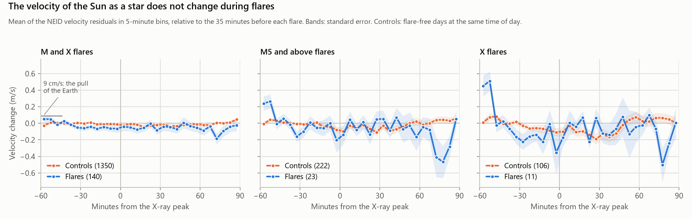
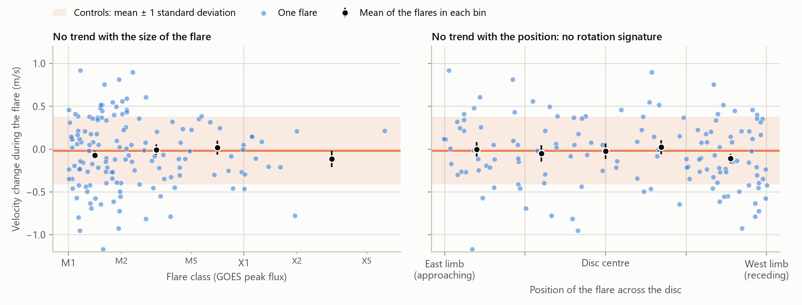

# FLINCH: resultados

Estado a 20 de noviembre de 2026. Todo lo que hay aquí se reproduce con `python -m flinch
pilot`; las tablas quedan en `results/` y las figuras en `results/figures/`.

## 1. La velocidad del Sol no cambia durante las fulguraciones

Con 140 fulguraciones de clase M y X medidas, la velocidad radial del Sol visto como estrella
no cambia de forma detectable durante la fulguración.

| Clase | Fulguraciones | Cambio medio (m/s) | Controles (m/s) | Diferencia (m/s) |
|---|---|---|---|---|
| M1 a M4 | 117 | −0,049 ± 0,039 | −0,012 ± 0,012 | −0,037 ± 0,041 |
| M5 a M9 | 12 | +0,017 ± 0,083 | −0,006 ± 0,037 | +0,023 ± 0,091 |
| X | 11 | −0,113 ± 0,095 | −0,077 ± 0,037 | −0,036 ± 0,102 |
| Todas | 140 | −0,048 ± 0,034 | −0,016 ± 0,011 | −0,032 ± 0,036 |

El cambio es la media de la velocidad entre el inicio de la fulguración y 2 minutos después
del máximo en rayos X, menos la media de los 35 minutos anteriores al inicio.

Cotas superiores al 95 %, contra muestras nulas de un control por fulguración:

| Magnitud | Exceso medido | Cota al 95 % |
|---|---|---|
| Cambio medio de una fulguración M o X | −0,03 m/s | 0,08 m/s |
| Cambio por fulguración de clase X1 (escalado con el flujo) | −0,01 m/s | 0,07 m/s |
| Término de rotación por X1 en el limbo | −0,09 m/s | 0,21 m/s |
| Cambio medio en la fase de decaimiento | −0,04 m/s | 0,10 m/s |

La señal que la Tierra imprime en el Sol es de 0,09 m/s. Una fulguración típica de clase M o
X mueve la velocidad menos que eso.

No hay tendencia con el tamaño de la fulguración ni con su posición en el disco. La segunda
es la prueba del desequilibrio de rotación: una mancha brillante en la mitad que se acerca
debería bajar la velocidad y en la que se aleja subirla.

## 2. Las fulguraciones no aumentan la amplitud de las oscilaciones del Sol

La potencia de las fluctuaciones de velocidad (dominada por las oscilaciones de 5 minutos) es
la misma en los 35 minutos posteriores al máximo que en los 35 anteriores al inicio.

| Magnitud | Fulguraciones | Muestras nulas | Cota al 95 % del exceso |
|---|---|---|---|
| ln(potencia después / antes) | −0,068 | 0,001 ± 0,053 | 0,16 |
| Lo mismo, pesando las frecuencias altas | −0,013 | −0,009 ± 0,060 | 0,10 |

En amplitud, un aumento medio superior al 8 % queda descartado. Es una prueba de la propuesta
de Karoff y Kjeldsen (2008), con la limitación de que la cadencia de 83 s solo llega a 6 mHz.

## 3. Cómo se ha medido

| Paso | Qué se hace |
|---|---|
| Calidad | Se descartan los espectros con error de velocidad no válido, con relación señal/ruido a más del 1 % de su mediana móvil (nubes) o a más de 5 sigmas de la tendencia del día, y los días con dispersión superior a 1,5 m/s. Quedan 233 857 de 366 180. |
| Tendencia diaria | Se resta un polinomio de grado 2 a cada día. La dispersión de un espectro es de 0,81 m/s, casi toda por las oscilaciones solares. |
| Muestra | Entran 140 fulguraciones con ventanas completas antes y durante: 137 de las 279 observadas en el pico y 3 con el pico justo fuera de la observación. De las 279 se pierden 53 por días descartados y 89 por ventanas incompletas, 38 de ellas porque la fulguración empezó al abrir el telescopio. |
| Controles | Para cada fulguración, hasta 10 épocas a la misma hora del día en días cercanos (±15) sin fulguraciones M o X. Son 1350. |
| Ruido | La dispersión de los controles da 0,39 m/s por fulguración. |
| Inyección | Una señal falsa de 1 m/s añadida a los datos brutos se recupera al 97 %. |

Los cortes de calidad se eligieron mirando solo el ruido de los controles y el número de
fulguraciones, nunca el resultado. Probar cortes más laxos cambia la sensibilidad menos de
un 10 %.

## 4. Lo que falta

- **Espectros.** Los índices cromosféricos y la forma del perfil medio de las líneas durante
  las fulguraciones más intensas. La descarga está en curso.
- **Controles para los espectros.** Ventanas sin fulguración a la misma hora, para saber qué
  variaciones son normales.
- **Eruptivas frente a confinadas.** Falta cruzar con el catálogo de eyecciones.
