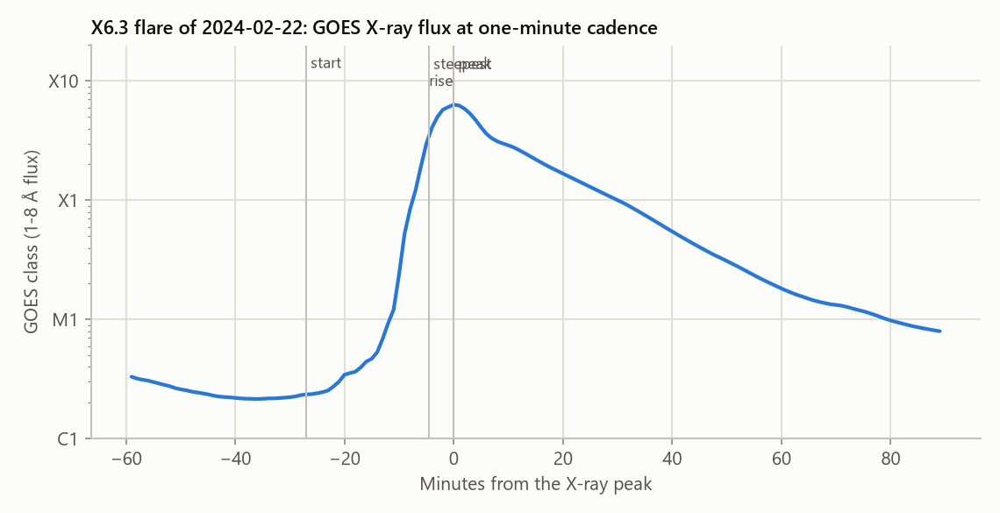

# Fulguraciones de GOES

La lista de fulguraciones dice cuándo empezó y cuándo alcanzó su máximo cada una, lo intensa
que fue y en qué lugar del disco ocurrió. Procede de los sensores de rayos X (XRS) de los
satélites meteorológicos GOES-R, que miden sin interrupción el flujo de todo el Sol en la
banda de 1 a 8 Å.

## Qué son los datos

Una fulguración se clasifica por su flujo máximo en esa banda: la clase M empieza en
10⁻⁵ W m⁻² y la clase X en 10⁻⁴ W m⁻², de modo que una X2.8 alcanza 2,8 × 10⁻⁴ W m⁻².

Se usan tres productos de calidad científica de NOAA/NCEI, todos públicos:

| Producto | Contenido | Tamaño |
|---|---|---|
| `xrsf-l2-flsum_science` | Un registro por cada marca (inicio, máximo, final) de cada fulguración | 6 MB por satélite |
| `xrsf-l2-flloc_science` | Posición de cada fulguración en el disco | 0,6 MB por satélite |
| `xrsf-l2-avg1m_science` | Flujo de rayos X del Sol cada minuto | 48 MB por satélite y año |

Están en
`https://data.ngdc.noaa.gov/platforms/solar-space-observing-satellites/goes/goes16/l2/data/`
(y `goes18`). GOES-16 cubre de febrero de 2017 a abril de 2025 y GOES-18 desde junio de 2022.

## Un ejemplo

Cuatro de las fulguraciones del 21 y 22 de febrero de 2024, tal como las lee FLINCH:

| Inicio (UT) | Subida más rápida | Máximo | Final | Clase | Fluencia (J m⁻²) | x | y | Satélite |
|---|---|---|---|---|---|---|---|---|
| 2024-02-21 22:52 | 23:04 | 23:06 | 23:13 | X1.8 | 0,098 | −0,60 | +0,34 | 16 |
| 2024-02-21 23:58 | 00:03 | 00:13 | 00:30 | M1.5 | 0,026 | −0,81 | −0,44 | 16 |
| 2024-02-22 06:17 | 06:30 | 06:32 | 06:38 | X1.6 | 0,087 | −0,55 | +0,34 | 16 |
| 2024-02-22 20:28 | 20:41 | 20:46 | 21:01 | M4.8 | 0,053 | −0,46 | +0,36 | 16 |

`x` e `y` son la posición en el disco en unidades del radio solar, con `x` positivo hacia el
limbo oeste, el que se aleja de nosotros.

El flujo minuto a minuto de la fulguración X6.3 del 22 de febrero de 2024, la más intensa del
disco en la muestra:

## Qué se espera de ellos

| Magnitud | Por qué importa |
|---|---|
| Instantes de inicio y de máximo | Sitúan las ventanas en las que se miden la velocidad y el espectro. |
| Subida más rápida | Marca la fase impulsiva, cuando las partículas aceleradas calientan la baja atmósfera. El máximo en rayos X llega después: 3,5 minutos en la mediana, hasta 10. |
| Clase (flujo máximo) | Una respuesta debería crecer con el tamaño de la fulguración, así que el flujo es el peso de las estimaciones escaladas. |
| Posición | Una mancha brillante sobre un disco que gira desplaza la velocidad con el signo de su lado: negativo en el este, positivo en el oeste. La posición convierte una media nula en una prueba con signo. |

## Cómo se procesan

1. **Una fila por fulguración.** El archivo resumen tiene un registro por marca; los registros
   se emparejan por su `flare_id` en inicio, máximo y final. Una fulguración en curso al
   acabar el archivo no tiene final.
2. **Posiciones.** El archivo de posiciones se une por `flare_id`. La posición
   helioproyectiva en segundos de arco se divide por el radio solar de ese día.
3. **Dos satélites, una lista.** GOES-16 es la lista principal. Una fulguración de GOES-18 se
   añade solo cuando su máximo está a más de 3 minutos de todos los máximos de GOES-16 y no
   cae entre el inicio y el final de una fulguración de GOES-16. Así se rellenan los huecos de
   GOES-16 y se continúa la lista desde abril de 2025. La lista unida tiene 21 459
   fulguraciones de todas las clases.
4. **Instante impulsivo.** La subida más rápida es el máximo de la diferencia centrada del
   flujo minuto a minuto entre el inicio y el máximo.

Las funciones están en [`flinch.goes`](../api/data.md).

## Advertencias

- **La clase depende del satélite** al nivel de unos pocos por ciento: la mayor fulguración
  de mayo de 2024 es X8.6 para GOES-16 y X8.5 para GOES-18.
- **Las posiciones salen del propio sensor de rayos X** (un diodo de cuadrantes), no de una
  imagen. No son fiables para fulguraciones débiles; para las M y X, el 98 % cae a menos de
  1,05 radios solares. La longitud y la latitud heliográficas no se dan en el limbo.
- **Eje de tiempos.** Los tiempos son segundos desde el 1 de enero de 2000 a las 12:00 UTC sin
  segundos intercalares, lo que reproduce los instantes de las fulguraciones al minuto. Una
  ambigüedad de 5 s no importaría frente a exposiciones de 55 s.
- **Escala de las clases.** Los flujos de los satélites anteriores a GOES-16 se daban
  multiplicados por 0,7. Las fulguraciones de septiembre de 2017, que registraron las dos
  generaciones de satélites, son entre 1,4 y 1,6 veces mayores en la lista de aquí. Las
  catalogadas como X9.3 el 6 de septiembre y como X8.2 el 10 de septiembre son aquí X14.6 y
  X12.9.
