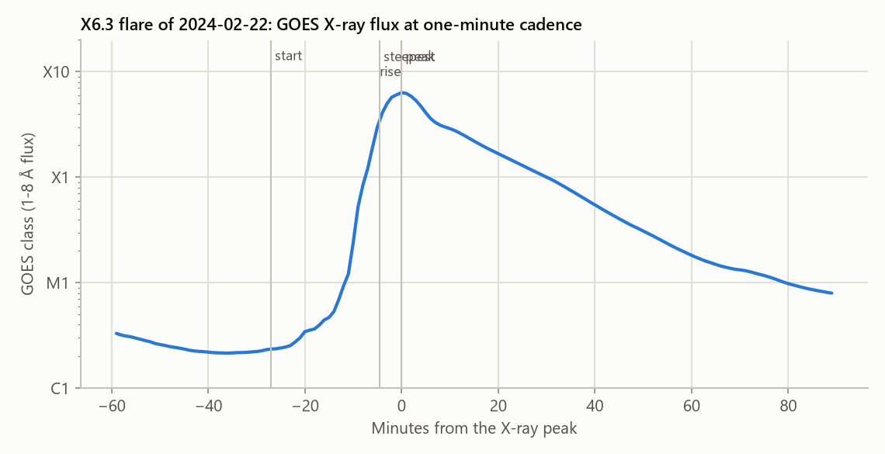

# GOES flares

The flare list says when each flare started and peaked, how strong it was and where on the
disc it happened. It comes from the X-ray sensors (XRS) of the GOES-R weather satellites,
which measure the flux of the whole Sun in the 1-8 Å band without interruption.

## What the data are

A flare is classified by its peak flux in that band: class M starts at 10⁻⁵ W m⁻² and class
X at 10⁻⁴ W m⁻², so an X2.8 flare peaks at 2.8 × 10⁻⁴ W m⁻².

Three science-quality products of NOAA/NCEI are used, all public:

| Product | Content | Size |
|---|---|---|
| `xrsf-l2-flsum_science` | One record per event marker (start, peak, end) of every flare | 6 MB per satellite |
| `xrsf-l2-flloc_science` | Position of each flare on the disc | 0.6 MB per satellite |
| `xrsf-l2-avg1m_science` | X-ray flux of the Sun every minute | 48 MB per satellite and year |

They are under
`https://data.ngdc.noaa.gov/platforms/solar-space-observing-satellites/goes/goes16/l2/data/`
(and `goes18`). GOES-16 covers February 2017 to April 2025 and GOES-18 from June 2022 on.

## An example

Four of the flares of 21 and 22 February 2024, as FLINCH reads them:

| Start (UT) | Steepest rise | Peak | End | Class | Fluence (J m⁻²) | x | y | Satellite |
|---|---|---|---|---|---|---|---|---|
| 2024-02-21 22:52 | 23:04 | 23:06 | 23:13 | X1.8 | 0.098 | −0.60 | +0.34 | 16 |
| 2024-02-21 23:58 | 00:03 | 00:13 | 00:30 | M1.5 | 0.026 | −0.81 | −0.44 | 16 |
| 2024-02-22 06:17 | 06:30 | 06:32 | 06:38 | X1.6 | 0.087 | −0.55 | +0.34 | 16 |
| 2024-02-22 20:28 | 20:41 | 20:46 | 21:01 | M4.8 | 0.053 | −0.46 | +0.36 | 16 |

`x` and `y` are the position on the disc in units of the solar radius, with `x` positive
towards the west limb, the one that moves away from us.

The one-minute flux of the X6.3 flare of 22 February 2024, the strongest flare on the disc
in the sample:

## What we expect from them

| Quantity | Why it matters |
|---|---|
| Start and peak times | They place the windows in which the velocity and the spectrum are measured. |
| Steepest rise | It marks the impulsive phase, when accelerated particles heat the lower atmosphere. The X-ray peak comes later: 3.5 minutes in the median, up to 10. |
| Class (peak flux) | A response should grow with the size of the flare, so the flux is the weight of the scaled estimates. |
| Position | A bright patch on a rotating disc shifts the velocity with the sign of its side: negative in the east, positive in the west. The position turns a null average into a signed test. |

## How they are processed

1. **One row per flare.** The summary file has one record per marker; records are paired by
   their `flare_id` into start, peak and end. A flare still in progress at the end of the
   file has no end.
2. **Positions.** The location file is joined on `flare_id`. The helioprojective position in
   arcseconds is divided by the solar radius of that day.
3. **Two satellites, one list.** GOES-16 is the primary list. A GOES-18 flare is added only
   when its peak is more than 3 minutes from every GOES-16 peak and does not fall between
   the start and the end of a GOES-16 flare. This fills the gaps of GOES-16 and continues
   the list after April 2025. The merged list has 21 459 flares of all classes.
4. **Impulsive time.** The steepest rise is the maximum of the centred difference of the
   one-minute flux between the start and the peak.

The functions are in [`flinch.goes`](../api/data.md).

## Caveats

- **The class depends on the satellite** at the level of a few per cent: the largest flare of
  May 2024 is X8.6 for GOES-16 and X8.5 for GOES-18.
- **Positions come from the X-ray sensor itself** (a quadrant diode), not from an image. They
  are unreliable for weak flares; for M and X flares 98 % fall within 1.05 solar radii.
  Heliographic longitude and latitude are not given for flares at the limb.
- **Time axis.** Times are seconds since 2000-01-01 12:00 UTC without leap seconds, which
  reproduces the flare times to the minute. An ambiguity of 5 s would not matter against
  55 s exposures.
- **The scale of the classes.** Fluxes of satellites before GOES-16 were reported multiplied
  by 0.7, so a flare of those lists is 1.4 times larger on the scale used here: the flare
  catalogued as X9.3 on 6 September 2017 is X14.6 here.
