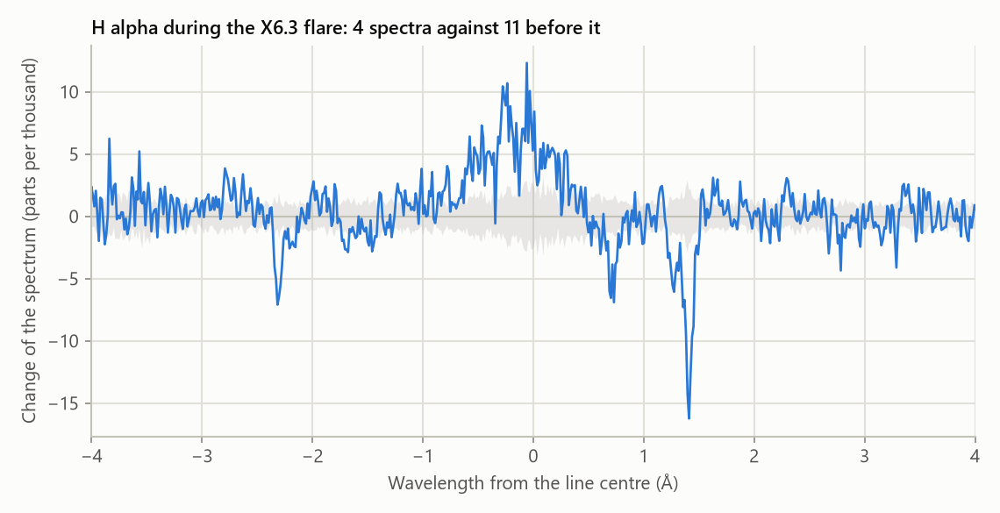
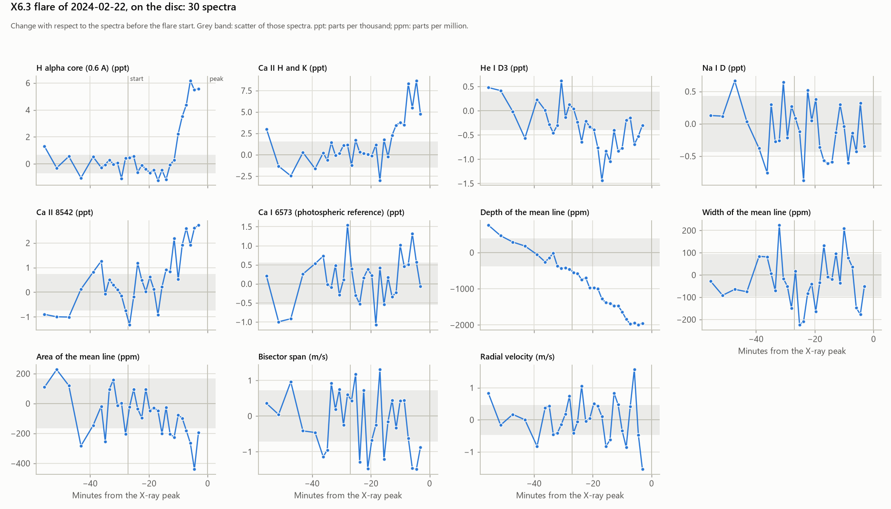

# Espectros de NEID

La velocidad es un número por espectro. El espectro dice mucho más: cómo se abrillanta cada
línea cromosférica durante una fulguración, y si cambia la forma de las líneas fotosféricas.

## Qué son los datos

Cada observación solar tiene un archivo FITS de nivel 2 de 113 MB. El archivo no sirve rangos
de bytes, así que cada uno se descarga entero de

```
https://neid.ipac.caltech.edu/get_file.php?filehand=<l2filepath>&solar
```

donde `l2filepath` es una columna de la tabla `neidsolarl2`. No hace falta registro. Las
extensiones que importan:

| Extensión | Contenido |
|---|---|
| `SCIFLUX`, `SCIWAVE`, `SCIVAR` | Espectro, longitudes de onda y varianzas de 122 órdenes × 9216 píxeles |
| `SCIFLUXSTITCH`, `SCIWAVESTITCH` | Los órdenes cosidos en un espectro de 493 473 píxeles, de 3670 a 10 200 Å |
| `CCFS` | Función de correlación cruzada de cada orden con una máscara G2, de −100 a +100 km/s en pasos de 0,25 km/s |
| `ACTIVITY` | Índices de actividad calculados por la cadena, con sus errores |

Las longitudes de onda están en el vacío, en el sistema del observador.

## Un ejemplo

Algunos de los índices del espectro tomado en el máximo de la mayor fulguración de mayo de
2024:

| Índice | Línea | Valor | Error | Error relativo |
|---|---|---|---|---|
| `CaIIHK` | Ca II H 3968 y K 3934 Å | 0,15142 | 0,00020 | 1,3 partes por mil |
| `HeI_1` | He I D3 5876 Å | 1,02783 | 0,00035 | 0,3 |
| `NaI` | Na I D 5890 y 5896 Å | 0,31891 | 0,00012 | 0,4 |
| `Ha06_1` | H alfa, núcleo de 0,6 Å | 0,20722 | 0,00013 | 0,6 |
| `CaI_1` | Ca I 6573 Å, fotosférica | 0,94910 | 0,00035 | 0,4 |
| `CaIRT2` | Ca II 8542 Å | 0,35119 | 0,00018 | 0,5 |

La mayoría de los índices vienen en dos versiones, con y sin corrección de las líneas
telúricas.

Cómo cambió H alfa durante la fulguración X6.3 del 22 de febrero de 2024: el espectro medio de
los últimos minutos antes del máximo dividido por el espectro medio anterior a la fulguración.



El núcleo de la línea se rellena entre un 0,5 y un 1 %. Las caídas estrechas son líneas
telúricas de agua, que se hacen más profundas al bajar el Sol hacia el horizonte: no son
solares.

## Qué se espera de ellos

- **Las líneas cromosféricas se abrillantan.** Una fulguración calienta la cromosfera y los
  núcleos de H alfa y de las líneas de Ca II pasan a emisión en la zona de la fulguración.
  Diluido en todo el disco es un cambio de partes por mil, al alcance de un solo espectro en
  una fulguración X.
- **La referencia fotosférica no se mueve.** El índice de Ca I es la comprobación: si también
  cambia, la causa es el cielo o el instrumento.
- **La línea media puede cambiar de forma.** La función de correlación cruzada es una línea
  media construida con miles de líneas. Su profundidad se conoce con 100 partes por millón por
  espectro y su bisector con unos 0,5 m/s, así que un cambio de forma podría verse incluso
  donde la velocidad no se mueve.

## Cómo se procesan

1. **Extraer y descartar.** De cada archivo FLINCH conserva la tabla de actividad, la suma de
   la función de correlación cruzada sobre los órdenes y seis ventanas del espectro cosido
   (Ca II H y K, H beta, Mg I b, He I D3 con Na I D, H alfa, Ca II 8542). El extracto ocupa
   0,2 MB; el archivo se borra.
2. **Muestreo.** En las fulguraciones X se toman todos los espectros desde 10 minutos antes
   del inicio hasta 15 después del máximo, y uno de cada tres desde 30 minutos antes del
   inicio hasta 45 después del máximo. En las de M5 a M9 se toma uno de cada dos espectros de
   cielo despejado desde 26 minutos antes del inicio hasta 10 después del máximo.
3. **Solo cielo despejado.** Se descartan los espectros cuya relación señal/ruido se aparta
   más de un 1 % de su mediana móvil, como en las velocidades.
4. **Línea base.** Cada magnitud se expresa como su cambio respecto a la media de los
   espectros tomados antes del inicio de la fulguración.
5. **Respuesta.** La respuesta de una fulguración es el cambio medio desde 8 minutos antes del
   máximo en rayos X hasta 10 minutos después.
6. **Controles.** Las mismas ventanas se miden en el día sin fulguraciones más próximo. La
   dispersión de sus respuestas se suma en cuadratura al error de cada fulguración, porque
   recoge las derivas lentas que el error propio no ve.
7. **Forma de la línea.** La función de correlación cruzada se normaliza por sus alas y se
   ajusta con una gaussiana (centro, profundidad, anchura); su área y su bisector se miden
   sobre un perfil remuestreado con un spline cúbico.

Las funciones están en [`flinch.spectra`, `flinch.response`, `flinch.chromosphere` y
`flinch.lineshape`](../api/spectra.md).



## Advertencias

- **Derivas lentas con la altura del Sol.** Las líneas telúricas y la extinción diferencial
  cambian los índices y la profundidad de la línea media en decenas de minutos. La profundidad
  derivó más de 2000 partes por millón en la hora de la figura de arriba, sin ningún escalón
  en la fulguración. Por eso hacen falta los controles.
- **Pocas ventanas de control.** Son nueve, todas de fulguraciones de clase X; la dispersión
  que dan se conoce con un 25 %.
- **El remuestreo importa.** La interpolación lineal de una línea muestreada cada 0,25 km/s
  se equivoca en partes en 10⁴ en el núcleo, y un bisector medido sobre las muestras brutas
  salta más de 1 m/s cuando cambia la muestra más baja. Las dos cosas se hacen sobre un spline.
