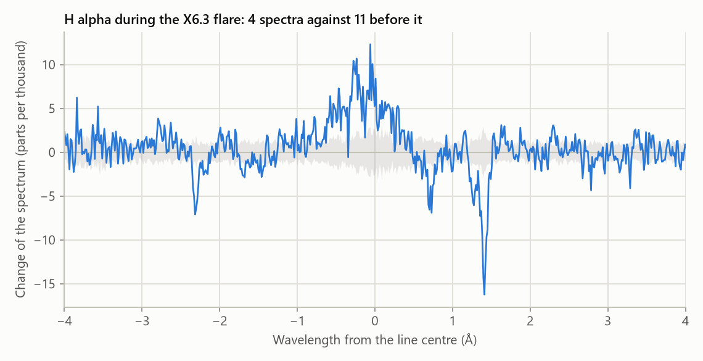
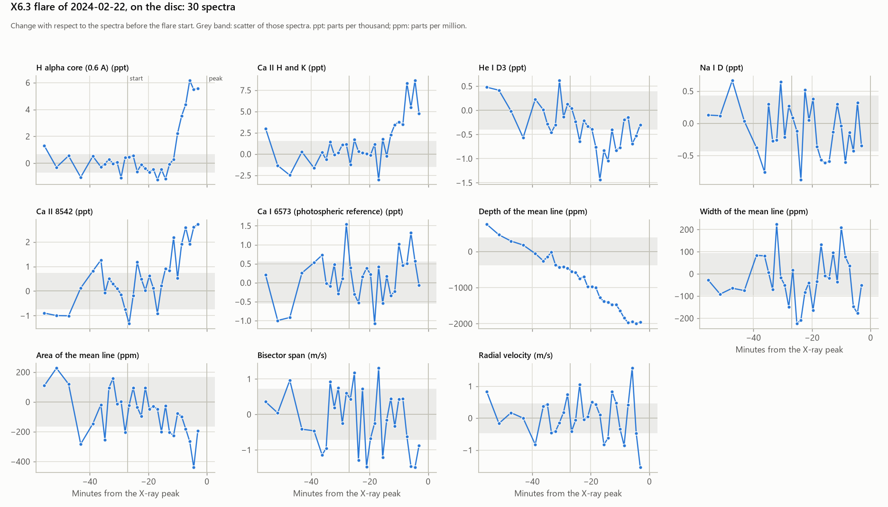

# NEID spectra

The velocity is one number per spectrum. The spectrum itself says much more: how each
chromospheric line brightens during a flare, and whether the shape of the photospheric
lines changes.

## What the data are

Each solar observation has a level-2 FITS file of 113 MB. The archive does not serve byte
ranges, so a file is downloaded whole from

```
https://neid.ipac.caltech.edu/get_file.php?filehand=<l2filepath>&solar
```

where `l2filepath` is a column of the table `neidsolarl2`. No login is needed. The
extensions that matter:

| Extension | Content |
|---|---|
| `SCIFLUX`, `SCIWAVE`, `SCIVAR` | Spectrum, wavelengths and variances of 122 orders × 9216 pixels |
| `SCIFLUXSTITCH`, `SCIWAVESTITCH` | The orders stitched into one spectrum of 493 473 pixels, 3670 to 10 200 Å |
| `CCFS` | Cross-correlation function of each order with a G2 mask, −100 to +100 km/s in steps of 0.25 km/s |
| `ACTIVITY` | Activity indices computed by the pipeline, with their errors |

Wavelengths are in vacuum, in the frame of the observer.

## An example

Some of the indices of the spectrum taken at the peak of the largest flare of May 2024:

| Index | Line | Value | Error | Relative error |
|---|---|---|---|---|
| `CaIIHK` | Ca II H 3968 and K 3934 Å | 0.15142 | 0.00020 | 1.3 parts per thousand |
| `HeI_1` | He I D3 5876 Å | 1.02783 | 0.00035 | 0.3 |
| `NaI` | Na I D 5890 and 5896 Å | 0.31891 | 0.00012 | 0.4 |
| `Ha06_1` | H alpha, 0.6 Å core | 0.20722 | 0.00013 | 0.6 |
| `CaI_1` | Ca I 6573 Å, photospheric | 0.94910 | 0.00035 | 0.4 |
| `CaIRT2` | Ca II 8542 Å | 0.35119 | 0.00018 | 0.5 |

Most indices come in two versions, with and without a correction for telluric lines.

How H alpha changed during the X6.3 flare of 22 February 2024, as the mean spectrum of the
last minutes before the peak divided by the mean spectrum before the flare:



The core of the line fills in by 0.5 to 1 %. The narrow dips are telluric water lines, which
deepen as the Sun sinks towards the horizon: they are not solar.

## What we expect from them

- **Chromospheric lines brighten.** A flare heats the chromosphere and the cores of H alpha
  and of the Ca II lines go into emission in the flaring area. Diluted over the whole disc
  this is a change of parts per thousand, within reach of a single spectrum for an X flare.
- **The photospheric reference does not move.** The Ca I index is the check: if it changes
  as well, the cause is the sky or the instrument.
- **The mean line may change shape.** The cross-correlation function is an average line
  built from thousands of lines. Its depth is known to 100 parts per million per spectrum
  and its bisector span to about 0.5 m/s, so a change of shape could show even where the velocity
  does not move.

## How they are processed

1. **Extract and discard.** From each file flinch keeps the activity table, the sum of the
   cross-correlation function over orders, and six wavelength windows of the stitched
   spectrum (Ca II H and K, H beta, Mg I b, He I D3 with Na I D, H alpha, Ca II 8542). The
   extract is 0.2 MB; the file is deleted.
2. **Sampling.** For the X-class flares, every spectrum from 10 minutes before the start to
   15 minutes after the peak, and one in three from 30 minutes before the start to 45 after
   the peak. For the flares between M5 and M9, every second clear-sky spectrum from 26
   minutes before the start to 10 after the peak.
3. **Clear sky only.** Spectra with a signal-to-noise ratio more than 1 % away from its
   running median are dropped, as for the velocities.
4. **Baseline.** Each quantity is expressed as its change with respect to the mean of the
   spectra taken before the start of the flare.
5. **Response.** The response of a flare is the mean change from 8 minutes before the X-ray
   peak to 10 minutes after it.
6. **Controls.** The same windows are measured on the nearest flare-free day. The scatter of
   their responses is added in quadrature to the error of each flare, because it contains
   the slow drifts that the error of the flare itself does not see.
7. **Line shape.** The cross-correlation function is normalised by its wings and fitted with
   a Gaussian (centre, depth, width); its area and bisector span are measured on a profile
   resampled with a cubic spline.

The functions are in [`flinch.spectra`, `flinch.response`, `flinch.chromosphere` and
`flinch.lineshape`](../api/spectra.md).



## Caveats

- **Slow drifts with the height of the Sun.** Telluric lines and differential extinction
  change the indices and the depth of the mean line over tens of minutes. The depth drifted
  by more than 2000 parts per million in the hour of the figure above, with no step at the
  flare. This is why the controls are needed.
- **Few control windows.** There are nine, all of X-class flares; the scatter they give is
  known to 25 %.
- **Resampling matters.** Linear interpolation of a line sampled every 0.25 km/s is wrong by
  parts in 10⁴ at the core, and a bisector measured on the raw samples jumps by more than
  1 m/s when the lowest sample changes. Both are done on a spline.
