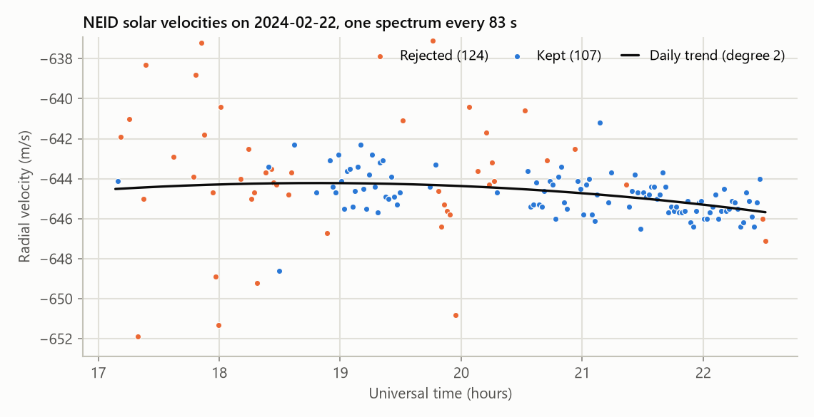

# Velocidades de NEID

NEID es un espectrógrafo construido para medir velocidades radiales con precisión extrema en
el telescopio WIYN de 3,5 m de Kitt Peak, en Arizona. Durante el día lo alimenta un pequeño
telescopio solar, de modo que el Sol se observa exactamente como se observaría una estrella:
un espectro de todo el disco cada 83 segundos, reducido con la misma cadena.

## Qué son los datos

El archivo de NEID en NExScI ofrece las observaciones solares como una tabla, `neidsolarl2`,
a través de un servicio TAP público (`https://neid.ipac.caltech.edu/TAP/sync`). No hay que
descargar ningún archivo para tener las velocidades. El 12 de noviembre de 2026 la tabla
tenía 366 180 espectros:

| Año | Días observados | Espectros |
|---|---|---|
| 2020 | 21 | 4 076 |
| 2021 | 334 | 70 722 |
| 2022 | 212 | 50 199 |
| 2023 | 310 | 72 146 |
| 2024 | 163 | 38 742 |
| 2025 | 302 | 70 390 |
| 2026 | 260 | 59 905 |

Las columnas que se usan:

| Columna | Significado |
|---|---|
| `obsjd` | Fecha juliana (UTC) del inicio de la exposición |
| `exptime` | Tiempo de exposición, 55 s |
| `ccfrvmod` | Velocidad radial en km/s, de la correlación cruzada con una máscara de líneas G2 |
| `dvrms` | Error fotónico de la velocidad en km/s, unos 0,3 m/s |
| `extsnr` | Relación señal/ruido del espectro extraído, unos 380 |
| `sunagl` | Altura del Sol sobre el horizonte, en grados |

## Un ejemplo

Cuatro espectros consecutivos del 22 de febrero de 2024, cuando llega una nube:

| Inicio (UT) | Velocidad (km/s) | Error (km/s) | S/R | S/R sobre su mediana móvil | Residuo (m/s) | Se conserva |
|---|---|---|---|---|---|---|
| 19:29:00 | −0,6447 | 0,0002 | 418 | 0,995 | −0,44 | sí |
| 19:30:22 | −0,6411 | 0,0003 | 303 | 0,721 | +3,17 | no |
| 19:31:45 | −0,5822 | 0,0012 | 76 | no válida | +62,07 | no |
| 19:33:08 | −0,6181 | 0,0020 | 46 | no válida | +26,18 | no |

El día entero: 231 espectros, de los que se conservan 107.

## Qué se espera de ellos

- **Una velocidad plana con un ruido conocido.** El Sol no se mueve: la velocidad de un día
  despejado es constante salvo una tendencia lenta de 1 o 2 m/s. La dispersión de un espectro
  alrededor de esa tendencia es de 0,8 m/s, tres veces el error fotónico, porque la superficie
  del Sol sube y baja con las oscilaciones de cinco minutos.
- **Sensibilidad promediando.** Una fulguración, con unos diez espectros durante ella y
  veinticinco antes, se mide con 0,4 m/s. Cien fulguraciones llegan a unos pocos cm/s.
- **Las nubes son el enemigo.** Una nube tapa parte de un disco que gira y desplaza la
  velocidad decenas de m/s. También baja la señal, y así se la reconoce.

## Cómo se procesan

1. **Tiempo.** `obsjd` es el inicio de la exposición; se le suma media exposición. La columna
   `ccfjdsum` es una fecha baricéntrica, siete minutos anterior, y no debe compararse con los
   instantes de las fulguraciones registrados en la Tierra.
2. **Cortes de calidad.** Un espectro se conserva cuando su error de velocidad es válido e
   inferior a 1 m/s, su relación señal/ruido supera 50 y está a menos del 1 % de su mediana
   móvil sobre 31 espectros, y su velocidad está a menos de 5 sigmas robustas de la tendencia
   del día.
3. **Tendencia diaria.** A los espectros conservados de cada día se les ajusta un polinomio de
   grado 2 y se les resta. Los días con menos de 40 espectros conservados, o con una
   dispersión superior a 1,5 m/s, se descartan enteros.

Tras los cortes quedan 233 857 espectros en 1238 días. La tolerancia del 1 % en la señal sale
de los datos: dentro de ella la dispersión robusta es de 0,85 a 1,0 m/s, y crece a 2,3 m/s al
3 % y a más de 5 m/s al 10 %.

Las funciones están en [`flinch.neid`](../api/data.md) y
[`flinch.quality`](../api/velocity.md).

## Advertencias

- **`airmass` no sirve**: contiene valores de relleno en muchos espectros solares. Se usa en
  su lugar la altura del Sol (`sunagl`).
- **`flagged` no se usa.** Marca el 2 % de los espectros, pero sus velocidades no son peores
  que el resto y su significado no está documentado en la tabla.
- **`rejected` vale siempre cero** en los espectros solares.
- **Versiones de la cadena.** El 94 % de los espectros se redujo con la versión 1.5.3 y el
  5 % con la 1.5.4; sus velocidades medianas difieren menos de 3 m/s. La tendencia diaria
  quita cualquier desfase.
- **Qué incluye la velocidad.** La tendencia diaria absorbe los efectos lentos de la rotación
  de la Tierra y de la extinción diferencial. El análisis nunca compara velocidades de días
  distintos.
- **Horario.** NEID observa el Sol entre las 16:30 y las 22:30 UT aproximadamente, así que
  las fulguraciones que alcanzan su máximo después de las 22:20 UT no tienen fase de
  decaimiento.
