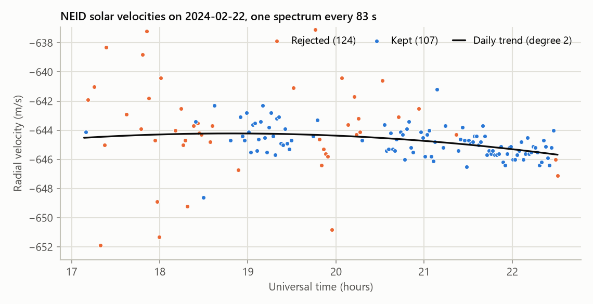

# NEID velocities

NEID is a spectrograph built for extreme-precision radial velocities on the WIYN 3.5 m
telescope at Kitt Peak, Arizona. A small solar telescope feeds it sunlight during the day, so
the Sun is observed exactly as a star would be: one disc-integrated spectrum every 83
seconds, reduced by the same pipeline.

## What the data are

The NEID archive at NExScI exposes the solar observations as a table, `neidsolarl2`,
through a public TAP service (`https://neid.ipac.caltech.edu/TAP/sync`). No file needs to
be downloaded to get the velocities. On 12 November 2026 the table had 366 180 spectra:

| Year | Days observed | Spectra |
|---|---|---|
| 2020 | 21 | 4 076 |
| 2021 | 334 | 70 722 |
| 2022 | 212 | 50 199 |
| 2023 | 310 | 72 146 |
| 2024 | 163 | 38 742 |
| 2025 | 302 | 70 390 |
| 2026 | 260 | 59 905 |

The columns used:

| Column | Meaning |
|---|---|
| `obsjd` | Julian date (UTC) of the start of the exposure |
| `exptime` | Exposure time, 55 s |
| `ccfrvmod` | Radial velocity in km/s, from the cross-correlation with a G2 line mask |
| `dvrms` | Photon-limited error of the velocity in km/s, about 0.3 m/s |
| `extsnr` | Signal-to-noise ratio of the extracted spectrum, about 380 |
| `sunagl` | Height of the Sun above the horizon, in degrees |

## An example

Four consecutive spectra of 22 February 2024, with a cloud arriving:

| Start (UT) | Velocity (km/s) | Error (km/s) | S/N | S/N over its running median | Residual (m/s) | Kept |
|---|---|---|---|---|---|---|
| 19:29:00 | −0.6447 | 0.0002 | 418 | 0.995 | −0.44 | yes |
| 19:30:22 | −0.6411 | 0.0003 | 303 | 0.721 | +3.17 | no |
| 19:31:45 | −0.5822 | 0.0012 | 76 | invalid | +62.07 | no |
| 19:33:08 | −0.6181 | 0.0020 | 46 | invalid | +26.18 | no |

The whole day: 231 spectra, of which 107 are kept.

## What we expect from them

- **A flat velocity with a known noise.** The Sun does not move: the velocity of a clear day
  is constant to within a slow trend of 1 or 2 m/s. The scatter of one spectrum about that
  trend is 0.8 m/s, three times the photon error, because the surface of the Sun rises and
  falls with the five-minute oscillations.
- **Sensitivity by averaging.** One flare, with some ten spectra during it and twenty-five
  before, is measured to 0.4 m/s. A hundred flares reach a few cm/s.
- **Clouds are the enemy.** A cloud covers part of a rotating disc and shifts the velocity
  by tens of m/s. It also lowers the signal, which is how it is recognised.

## How they are processed

1. **Time.** `obsjd` is the start of the exposure; half the exposure is added. The column
   `ccfjdsum` is a barycentric date, seven minutes earlier, and must not be compared with
   flare times recorded at the Earth.
2. **Quality cuts.** A spectrum is kept when its velocity error is valid and below 1 m/s,
   its signal-to-noise ratio is above 50 and within 1 % of its running median over 31
   spectra, and its velocity is within 5 robust sigmas of the trend of the day.
3. **Daily trend.** A polynomial of degree 2 is fitted to the kept spectra of each day and
   subtracted. Days with fewer than 40 kept spectra, or with a scatter above 1.5 m/s, are
   dropped whole.

After the cuts 233 857 spectra remain, on 1238 days. The 1 % tolerance on the signal comes
from the data: within it the robust scatter is 0.85 to 1.0 m/s, and it grows to 2.3 m/s at
3 % and beyond 5 m/s at 10 %.

The functions are in [`flinch.neid`](../api/data.md) and
[`flinch.quality`](../api/velocity.md).

## Caveats

- **`airmass` is not usable**: it holds placeholder values for many solar spectra. The
  height of the Sun (`sunagl`) is used instead.
- **`flagged` is not used.** It marks 2 % of the spectra, but their velocities are not worse
  than the rest and its meaning is not documented in the table.
- **`rejected` is always zero** for the solar spectra.
- **Pipeline versions.** 94 % of the spectra were reduced with version 1.5.3 and 5 % with
  1.5.4; their median velocities differ by less than 3 m/s. The daily trend removes any offset.
- **What the velocity includes.** The daily trend absorbs the slow effects of the rotation
  of the Earth and of differential extinction. The analysis never compares velocities of
  different days.
