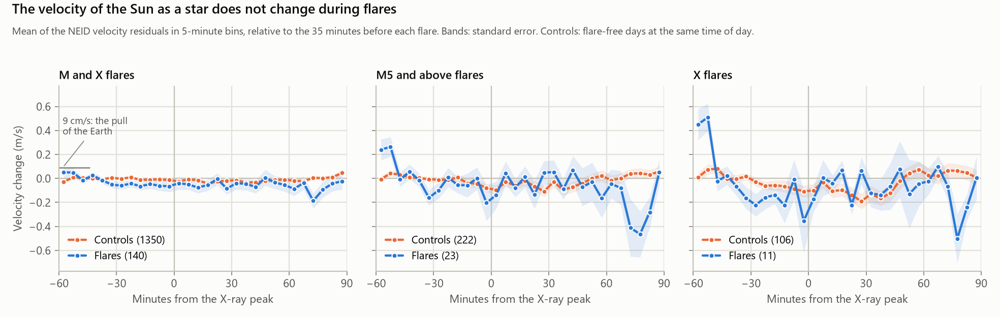

# FLINCH

**FL**are-**IN**duced **CH**anges in Sun-as-a-star radial velocities.

*Does the Sun flinch when it flares?*

Spectrographs built to find exoplanets measure the velocity of a star to a few tens of
centimetres per second. One of them, NEID, also observes the Sun every clear day as if it were
a distant star, one spectrum every 83 seconds. FLINCH cross-matches those spectra with the
solar flares recorded by the GOES satellites and asks three questions:

1. Does a flare move the radial velocity of the Sun seen as a star?
2. From which flare size, and by how much?
3. What does that imply for planet searches around Sun-like stars, where a flare cannot be
   seen separately?

The yardstick is the reflex velocity that the Earth imprints on the Sun: 9 cm/s.

## Results so far

!!! note "Status: work in progress (November 2026)"
    The velocity analysis is complete. The spectral analysis rests on twelve flares and
    nine flare-free control windows.

| Question | Answer | Evidence |
|---|---|---|
| Does the velocity change during a flare? | No, within 7 cm/s | Two instruments that saw different flares: −0.035 ± 0.035 m/s for 139 flares with NEID, −0.021 ± 0.039 m/s for 115 with HARPS-N |
| Is there a rotation signature (opposite sign east and west)? | No | −0.01 ± 0.04 m/s per X1 flare at the limb, both instruments together |
| Do flares excite the five-minute oscillations? | No, within 8 % in amplitude | Power after against before, 140 flares |
| Do the same spectra see the flares? | Yes: the chromospheric lines brighten | Ca II H and K rise in all 8 X flares on the disc, 6 of them above 3 sigma |

The Sun does not flinch, but it blushes: the chromospheric lines brighten while the velocity
stays put. See [Results](results.md).

## What is in this documentation

| Page | Content |
|---|---|
| [Getting started](getting-started.md) | Installation and the commands |
| [GOES flares](data/goes.md) | The flare lists: what they contain, an example, how they are processed |
| [NEID velocities](data/neid-velocities.md) | The velocity table: columns, quality cuts, daily trend |
| [NEID spectra](data/neid-spectra.md) | The spectra: what is extracted from each 113 MB file |
| [HARPS-N velocities](data/harpsn.md) | The second instrument: what it is and how it is processed |
| [Method](method.md) | Sample, controls, estimators and error bars |
| [Results](results.md) | Tables and figures |
| [Reproducing the results](reproduce.md) | Which command makes which table and figure |

All data are public and need no registration.
