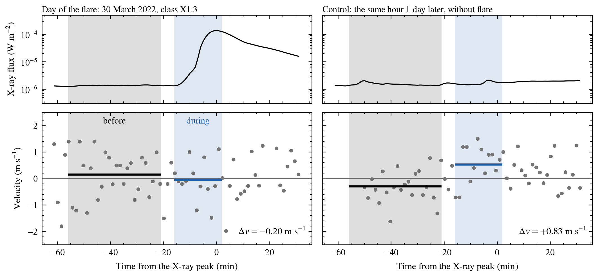

# Método

La medida tiene cuatro pasos. La figura los muestra para una fulguración.

*Izquierda: la fulguración X1.3 del 30 de marzo de 2022. Derecha: uno de sus días de control,
la misma hora un día después. Arriba: flujo de rayos X. Abajo: velocidades de NEID tras quitar
la tendencia del día, un punto por espectro. La banda gris es la ventana anterior a la
fulguración («before») y la azul la ventana durante su subida («during»); las líneas gruesas
son la velocidad media en cada una. Una sola fulguración o un solo control cambian decenas de
cm/s por azar; solo la media de muchas fulguraciones, comparada con sus controles, alcanza la
precisión necesaria.*

1. **Limpiar las velocidades**: quitar las tomadas con nubes y la tendencia lenta de cada día.
2. **Para cada fulguración**, tomar la velocidad media durante su subida menos la velocidad
   media justo antes.
3. **Repetir el paso 2 en días sin fulguraciones**, a la misma hora (los controles), y restar
   su cambio medio al de la fulguración.
4. **Promediar** todas las fulguraciones.

## Paso 1: limpiar las velocidades

Una nube que tapa parte del disco en rotación desplaza la velocidad decenas de m/s. En NEID
se conserva un espectro cuando su relación señal/ruido está a menos del 1 % de la de sus
vecinos, su error de velocidad es inferior a 1 m/s y su velocidad está a menos de cinco
desviaciones típicas de la tendencia del día. En HARPS-N se usa el indicador de calidad de su
publicación de datos (superior a 0,99).

La velocidad deriva lentamente a lo largo del día, por la rotación de la Tierra y por el
cambio de altura del Sol. A cada día se le ajusta un polinomio de grado 2 y se le resta. Los
días con pocas velocidades buenas, o con una dispersión superior a 1,5 m/s, se descartan.

| | NEID | HARPS-N |
|---|---|---|
| Velocidades conservadas | 233 857 | 93 593 |
| Días | 1238 | 1671 |
| Dispersión de una velocidad | 0,81 m/s | 0,44 m/s |

Detalles en [Velocidades de NEID](data/neid-velocities.md) y
[Velocidades de HARPS-N](data/harpsn.md).

## Paso 2: el cambio de velocidad de una fulguración

| Ventana | Límites |
|---|---|
| Antes | De 40 a 5 minutos antes del inicio de la fulguración |
| Durante | Del inicio a 2 minutos después del máximo en rayos X (la subida de la fulguración) |

**Δv = velocidad media durante − velocidad media antes**

Una fulguración solo cuenta si las dos ventanas contienen al menos el 70 % de las velocidades
esperadas.

| Paso | NEID | HARPS-N |
|---|---|---|
| Fulguraciones M y X en los años del instrumento | 2122 | 1750 |
| Con las dos ventanas completas | 140 | 122 |
| Con al menos tres controles | 139 | 115 |

## Paso 3: los controles

La velocidad del Sol cambia todo el tiempo, haya fulguración o no. Para saber qué añade una
fulguración se miden las mismas dos ventanas en otros días a la misma hora, hasta 15 días
antes y después, sin ninguna fulguración M o X a menos de 45 minutos. Desplazar días enteros
conserva la altura del Sol y el ciclo diario del instrumento.

**d = Δv de la fulguración − Δv medio de sus controles**

Si las fulguraciones no le hacen nada a la velocidad, la media de *d* es cero.

## Paso 4: las medias {#three-estimates}

| Número | Definición | Qué pone a prueba |
|---|---|---|
| Cambio medio | Media de *d* | Cualquier desplazamiento común a las fulguraciones |
| Desplazamiento de una X1, *S* | Σ *f d* / Σ *f*² | Un desplazamiento que crece con el tamaño de la fulguración |
| Término de rotación, *R* | Σ (*f v*) *d* / Σ (*f v*)² | Un desplazamiento con el signo del lado del disco |

*f* es el tamaño de la fulguración, su flujo máximo en unidades de X1 (0,1 para una M1, 2 para
una X2). *v* es su posición: la velocidad de rotación en la fulguración como fracción de la
del limbo (−1 en el limbo este, +1 en el limbo oeste).

El término de rotación es la única prueba cuyo signo puede predecirse. Una fulguración es una
mancha brillante sobre un disco que gira, así que debería desplazar la velocidad

**desplazamiento ≈ (ΔF / F) · v_rot · K**

donde ΔF / F es la fracción en que la fulguración abrillanta el Sol en luz visible, v_rot la
velocidad de rotación en la fulguración (hasta 1845 m/s en el limbo, visto desde la Tierra) y K un factor entre 0 y
1. K vale 1 si la luz añadida lleva las mismas líneas de absorción que la superficie que
tiene debajo, y 0 si es luz sin líneas, que solo hace menos profundas las líneas del resto
del disco.

## Errores, cotas y sensibilidad

- **Errores.** Las fulguraciones de un mismo día no son independientes. El cálculo se repite
  miles de veces con una selección al azar de los días de observación (un *bootstrap*); la
  dispersión de los resultados es el error.
- **Cotas.** Cuando un resultado *x* con error *σ* es compatible con cero, el mayor valor que
  podría esconder con una confianza del 95 % es |*x*| + 1,645 *σ*.
- **Dos instrumentos.** Se combinan pesando cada uno con el inverso del cuadrado de su error.
- **Sensibilidad.** Se añade un desplazamiento conocido a las velocidades publicadas en la
  ventana «durante» de épocas de control, y se repite toda la medida.

## Los espectros

Cada espectro de NEID viene con índices que miden cuánto brillan los núcleos de las líneas
cromosféricas. La respuesta de un índice a una fulguración es su media desde 8 minutos antes
del máximo en rayos X hasta 10 minutos después, menos su media antes del inicio. Lo mismo se
mide en ventanas de control. Véase [Espectros de NEID](data/neid-spectra.md).

## Qué se fijó y cuándo

Los cortes de calidad se eligieron mirando el ruido de los controles y el número de
fulguraciones, nunca el resultado. Las ventanas se fijaron después de un primer vistazo a los
datos de NEID, no antes; la [tabla de robustez](results.md#el-resultado-no-depende-de-las-decisiones)
muestra el resultado con las alternativas. HARPS-N se analizó después, una sola vez, con las
decisiones ya tomadas.
