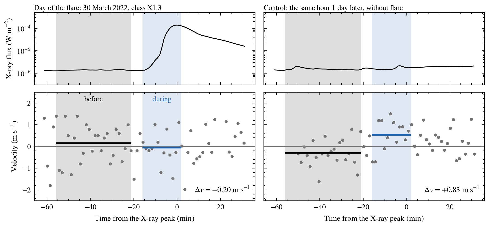

# Method

The measurement has four steps. The figure shows them for one flare.

*Left: the X1.3 flare of 30 March 2022. Right: one of its control days, the same hour a day
later. Top: X-ray flux. Bottom: NEID velocities after removing the trend of the day, one point
per spectrum. The grey band is the window before the flare and the blue band the window during
its rise; the thick lines are the mean velocity in each. One flare or one control changes by
tens of cm/s by chance; only the average over many flares, compared with their controls,
reaches the precision needed.*

1. **Clean the velocities**: drop those taken through clouds and remove the slow trend of
   each day.
2. **For each flare**, take the mean velocity during its rise minus the mean velocity just
   before it.
3. **Repeat step 2 on days without flares**, at the same hour (the controls), and subtract
   their mean change from that of the flare.
4. **Average** over all the flares.

## Step 1: cleaning the velocities

A cloud that covers part of the rotating disc shifts the velocity by tens of m/s. For NEID a
spectrum is kept when its signal-to-noise ratio is within 1 % of that of its neighbours, its
velocity error is below 1 m/s and its velocity is within five standard deviations of the trend
of the day. For HARPS-N the quality flag of its data release is used (above 0.99).

The velocity drifts slowly through the day, because of the rotation of the Earth and of the
changing height of the Sun. A polynomial of degree 2 is fitted to each day and subtracted.
Days with too few good velocities, or with a scatter above 1.5 m/s, are dropped.

| | NEID | HARPS-N |
|---|---|---|
| Velocities kept | 233 857 | 93 593 |
| Days | 1238 | 1671 |
| Scatter of one velocity | 0.81 m/s | 0.44 m/s |

Details in [NEID velocities](data/neid-velocities.md) and [HARPS-N velocities](data/harpsn.md).

## Step 2: the velocity change of a flare

| Window | Limits |
|---|---|
| Before | From 40 to 5 minutes before the start of the flare |
| During | From the start to 2 minutes after the X-ray peak (the rise of the flare) |

**Δv = mean velocity during − mean velocity before**

A flare counts only if both windows hold at least 70 % of the velocities expected.

| Step | NEID | HARPS-N |
|---|---|---|
| M and X flares in the years of the instrument | 2122 | 1750 |
| With both windows complete | 140 | 122 |
| With at least three controls | 139 | 115 |

## Step 3: the controls

The velocity of the Sun changes all the time, flare or no flare. To know what a flare adds,
the same two windows are measured on other days at the same hour, up to 15 days before and
after, with no M or X flare within 45 minutes. Shifting by whole days keeps the height of the
Sun and the daily cycle of the instrument.

**d = Δv of the flare − mean Δv of its controls**

If flares do nothing to the velocity, *d* averages to zero.

## Step 4: averages {#three-estimates}

| Number | Definition | What it tests |
|---|---|---|
| Mean change | Mean of *d* | Any shift common to the flares |
| Shift of an X1 flare, *S* | Σ *f d* / Σ *f*² | A shift that grows with the size of the flare |
| Rotation term, *R* | Σ (*f v*) *d* / Σ (*f v*)² | A shift with the sign of the side of the disc |

*f* is the size of the flare, its peak flux in units of X1 (0.1 for M1, 2 for X2). *v* is its
position: the rotation velocity at the flare as a fraction of that at the limb (−1 at the
east limb, +1 at the west limb).

The rotation term is the one test whose sign can be predicted. A flare is a bright patch on a
rotating disc, so it should shift the velocity by

**shift ≈ (ΔF / F) · v_rot · K**

where ΔF / F is the fraction by which the flare brightens the Sun in visible light, v_rot the
rotation velocity at the flare (up to 1845 m/s at the limb, as seen from the Earth) and K a factor between 0 and 1. K
is 1 if the extra light carries the same absorption lines as the surface under it, and 0 if
it is light without lines, which only makes the lines of the rest of the disc shallower.

## Errors, limits and sensitivity

- **Errors.** Flares of the same day are not independent. The calculation is repeated
  thousands of times with a random selection of the observing days (a bootstrap); the spread
  of the results is the error.
- **Limits.** When a result *x* with error *σ* is compatible with zero, the largest value it
  could hide with 95 % confidence is |*x*| + 1.645 *σ*.
- **Two instruments.** They are combined by weighting each with the inverse of the square of
  its error.
- **Sensitivity.** A known shift is added to the published velocities during the "during"
  window of control epochs, and the whole measurement is repeated.

## The spectra

Each NEID spectrum comes with indices that measure how bright the cores of chromospheric
lines are. The response of an index to a flare is its mean from 8 minutes before the X-ray
peak to 10 minutes after it, minus its mean before the start. The same is measured in control
windows. See [NEID spectra](data/neid-spectra.md).

## What was fixed when

The quality cuts were chosen from the noise of the controls and the number of flares, never
from the result. The windows were fixed after a first look at the NEID data, not before; the
[robustness table](results.md#the-result-does-not-depend-on-the-choices) shows the result
with the alternatives. HARPS-N was analysed afterwards, once, with the choices already made.
