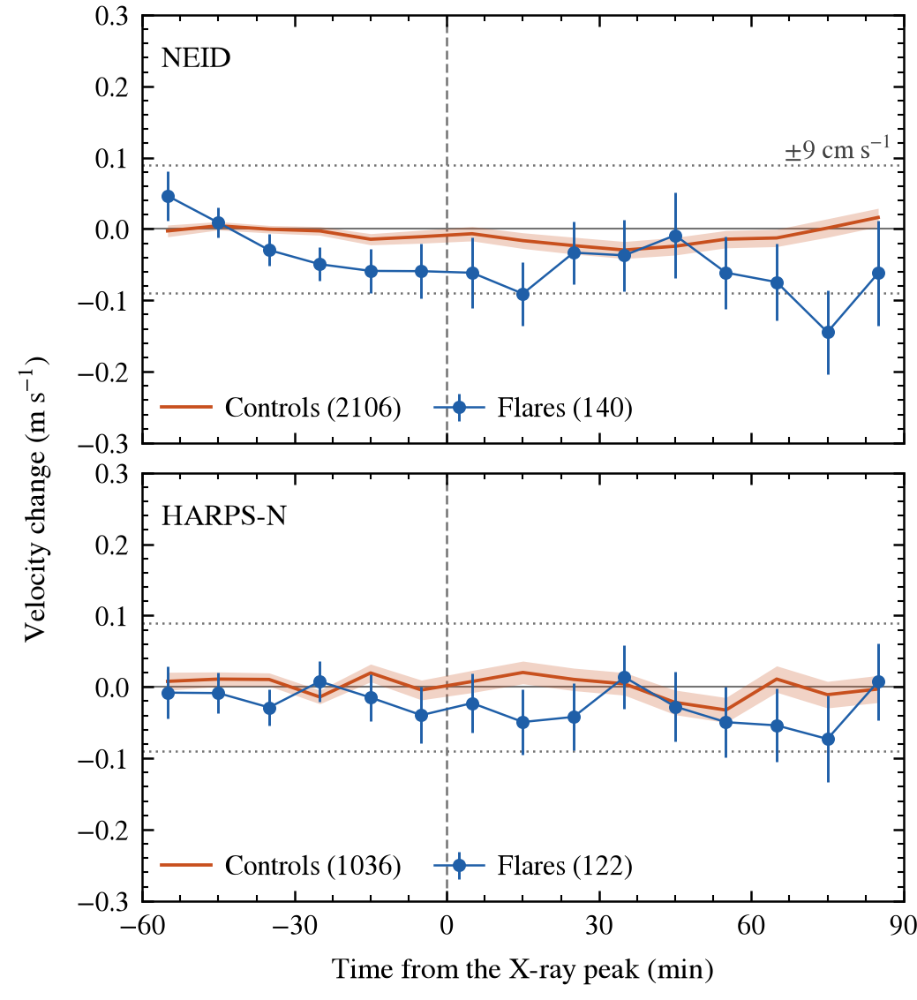
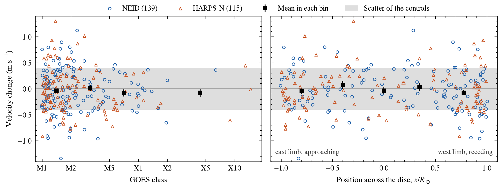
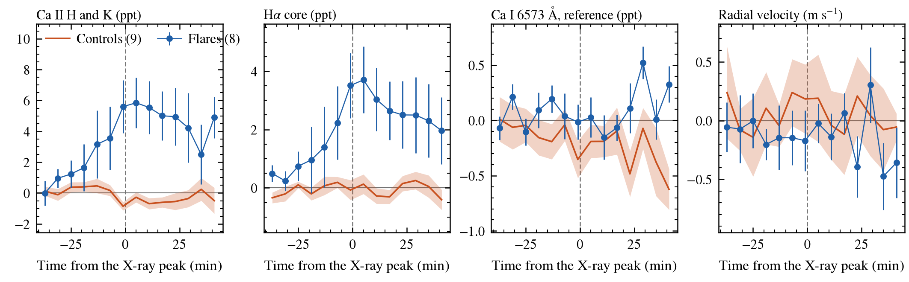
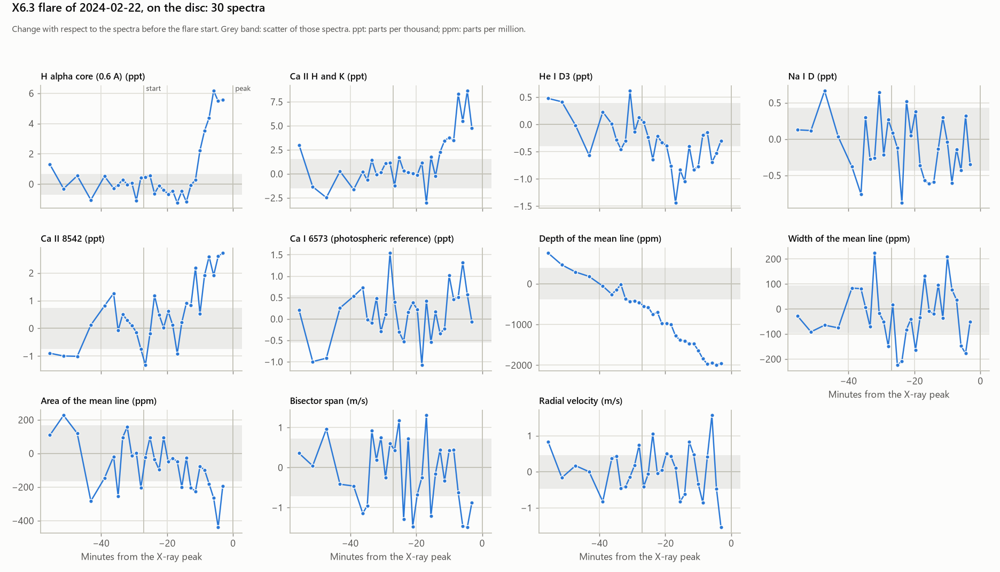

# Results

Status: November 2026. The velocity is measured with two instruments; the spectral results
rest on 12 flares and nine control windows of NEID.

## The velocity of the Sun does not change during flares

Two instruments that watched different flares give the same answer: the radial velocity of the
Sun seen as a star does not change during a flare.

Change of the velocity during the flare, minus that of its controls, in m/s:

| Flares | NEID | HARPS-N | Both | 95 % limit |
|---|---|---|---|---|
| M and X | −0.035 ± 0.035 (139) | −0.021 ± 0.039 (115) | −0.029 ± 0.026 (254) | 0.07 |
| M1 to M4 | −0.039 ± 0.041 (116) | +0.006 ± 0.044 (97) | −0.018 ± 0.030 (213) | 0.07 |
| M5 to M9 | +0.035 ± 0.086 (12) | −0.206 ± 0.078 (11) | −0.098 ± 0.058 (23) | 0.19 |
| X | −0.060 ± 0.088 (11) | −0.104 ± 0.127 (7) | −0.074 ± 0.072 (18) | 0.19 |
| Shift per X1 flare | −0.010 ± 0.061 | −0.005 ± 0.040 | −0.006 ± 0.033 | 0.06 |
| Rotation term per X1 flare at the limb | −0.106 ± 0.082 | +0.022 ± 0.043 | −0.006 ± 0.038 | 0.07 |

In brackets, the number of flares. "Both" weights each instrument by the inverse of its
variance; one flare is in both samples. The limit is the absolute value plus 1.645 errors.
Together the mean change is below 0.07 m/s, less than the 0.09 m/s that the Earth imprints on
the Sun.

- **No trend with the size of the flare or with its position** on the disc.
- **No hidden responses of varying sign**: the scatter of the changes of the flares (0.40 m/s
  with NEID, 0.41 with HARPS-N) equals that of their controls (0.40 and 0.41).
- **One row stands out**, the 11 flares between M5 and M9 with HARPS-N. Those flares happen
  to scatter less than usual (0.29 against 0.41 m/s), which makes their error small: sets of
  11 control epochs are as far from zero 10 % of the time, and NEID does not repeat the
  value. In the rows with about ten flares the error is itself uncertain by a quarter.

In physical terms the limit on the rotation term means K · ΔF / F < 3.5 × 10⁻⁵ per X1 flare,
with ΔF / F the relative brightening in the visible and K a factor between 0 (the extra light
is a continuum without lines, which does not shift the lines of the rest of the disc) and 1
(it carries the lines of the photosphere under it). See [Method](method.md#three-estimates).

Reproduce it with `python -m flinch replication`.

## The result does not depend on the analysis choices

With NEID, where the choices were made (HARPS-N was analysed afterwards, once, with them):

| Variant | Flares | Mean change | Per X1 | Rotation per X1 |
|---|---|---|---|---|
| Default | 139 | −0.035 ± 0.035 | −0.010 ± 0.061 | −0.106 ± 0.082 |
| Day polynomial of degree 1 | 137 | −0.022 ± 0.036 | −0.015 ± 0.060 | −0.045 ± 0.080 |
| Day polynomial of degree 3 | 139 | −0.001 ± 0.033 | +0.016 ± 0.049 | −0.079 ± 0.083 |
| Window: 3 min either side of the steepest X-ray rise | 120 | −0.009 ± 0.042 | −0.019 ± 0.061 | −0.108 ± 0.135 |
| Window: first 10 min from the start | 134 | −0.040 ± 0.035 | +0.006 ± 0.045 | −0.004 ± 0.080 |
| Window: 5 min either side of the X-ray peak | 126 | −0.021 ± 0.042 | −0.111 ± 0.085 | −0.134 ± 0.154 |
| Background: straight line fitted on both sides | 93 | −0.008 ± 0.040 | −0.032 ± 0.070 | −0.002 ± 0.113 |
| Bootstrap over 81 active regions instead of 111 days | 139 | −0.035 ± 0.035 | −0.010 ± 0.061 | −0.106 ± 0.082 |
| X-class flares only | 11 | −0.060 ± 0.088 | +0.011 ± 0.065 | −0.051 ± 0.104 |

All in m/s, with errors from the bootstrap over days. Same-day controls exist for 8 flares
and say nothing: +0.07 ± 0.17 m/s.

### Demonstrated sensitivity

| Injected signal | Recovered | Probability of detecting it at 95 % |
|---|---|---|
| 5 cm/s | 4.9 cm/s | 40 % |
| 10 cm/s | 9.8 cm/s | 88 % |
| 20 cm/s | 19.5 cm/s | 100 % |
| 50 cm/s | 48.8 cm/s | 100 % |

With HARPS-N the same injection test recovers 98 % of the signal. With the error of the two
instruments together, a shift of 10 cm/s common to all flares would have been detected with a
probability of 98 %.

## Flares do not raise the amplitude of the solar oscillations

| Quantity | Flares | Null samples | 95 % limit on the excess |
|---|---|---|---|
| ln(power after / before) | −0.068 | 0.001 ± 0.053 | 0.16 |
| The same, weighting high frequencies | −0.013 | −0.009 ± 0.060 | 0.10 |

A mean increase above 8 % in amplitude is ruled out (NEID). This tests the proposal of Karoff
and Kjeldsen (2008), with the limitation that the 83 s cadence reaches only 6 mHz. This test is
not part of the paper, which keeps to the velocity and the spectra.

## An excess before the X-class flares of NEID that HARPS-N does not see

In the ten minutes from 60 to 50 minutes before the X-ray peak, the X-class flares observed by
NEID sit 0.44 ± 0.11 m/s above the trend of their day (19 flares with data at that time, 17 of
them positive). It was noticed in the stacked velocities, not predicted. It is absent in the
M-class flares of NEID (0.00 ± 0.03 m/s) and in the controls, and HARPS-N does not show it:
−0.12 ± 0.11 m/s for its ten X-class flares. A change on the Sun would be seen by both
instruments, so it is not attributed to the Sun; it is unexplained.

## The same spectra do see the flares

The null result in velocity is not due to spectra that miss the flares. In the spectra of
the strongest flares the chromospheric indices rise when the flare is on the disc, while the
velocity of the same spectra stays flat.

The indices rise with the X-ray flux, peak a few minutes after the X-ray peak and are still
high 40 minutes later; the controls stay flat. One flare in detail:

Twelve X flares have usable spectra, and nine flare-free control windows were measured in the
same way. The response is the mean change from 8 minutes before the X-ray peak to 10 minutes
after it, in parts per thousand. The error of a flare adds in quadrature the scatter of its
own spectra before the flare and the scatter of the controls, which includes the slow drifts
with the height of the Sun.

| Index | Detected above 3 sigma (of 12) | Mean on the disc (8 flares) | Mean near the limb (4) | Scatter of the controls (9) |
|---|---|---|---|---|
| Ca II H and K | 7 | +5.3 ± 1.7 | +1.7 ± 0.9 | 0.66 ± 0.16 |
| H alpha, 0.6 Å core | 4 | +3.3 ± 1.1 | +0.8 ± 0.6 | 0.63 ± 0.16 |
| H beta core (own index) | 3 | +2.2 ± 0.5 | +0.9 ± 0.5 | 0.60 ± 0.15 |
| Ca II 8542 | 3 | +2.2 ± 0.7 | +0.9 ± 0.4 | 0.56 ± 0.14 |
| H alpha, 1.6 Å band | 2 | +1.1 ± 0.3 | +0.4 ± 0.2 | 0.32 ± 0.08 |
| Ca I 6573 (photospheric reference) | 0 | 0.0 ± 0.2 | +0.2 ± 0.3 | 0.21 ± 0.05 |
| Radial velocity (m/s) | 0 | −0.11 ± 0.21 | −0.06 ± 0.08 | 0.81 ± 0.20 |

The errors of the means are standard errors over the flares, which differ a lot from one
another (H alpha goes from +1.1 to +10.9 on the disc). The scatter of nine controls is itself
known to 24 %. He I D3, Na I D, Na I 8183 and 8195, Paschen delta, Mn I 5395 and Mg I b2 do
not respond.

Flare by flare, with the candidate coronal mass ejection from the LASCO catalogue:

| Flare | Distance from disc centre | CME | Ca II H and K | H alpha core | Velocity (m/s) |
|---|---|---|---|---|---|
| X1.9, 2026-01-18 | 0.36 | yes | +17.0 ± 1.7 | +10.9 ± 0.7 | −1.4 ± 0.9 |
| X1.1, 2026-06-30 | 0.39 | yes | +4.7 ± 0.9 | +3.6 ± 0.7 | −0.1 ± 0.9 |
| X1.2, 2025-06-17 | 0.36 | no | +4.0 ± 0.9 | +3.0 ± 0.7 | +0.5 ± 0.9 |
| X1.1, 2024-05-09 | 0.53 | yes | +5.0 ± 0.9 | +2.8 ± 0.7 | +0.3 ± 0.9 |
| X1.9, 2023-01-09 | 0.97 | no | +4.3 ± 0.8 | +2.2 ± 0.8 | 0.0 ± 0.9 |
| X1.3, 2022-03-30 | 0.58 | yes | +2.9 ± 0.8 | +2.0 ± 0.7 | −0.4 ± 0.9 |
| X2.8, 2023-12-14 | 0.76 | yes | +4.0 ± 1.5 | +1.6 ± 0.6 | −0.4 ± 0.8 |
| X1.0, 2024-06-01 | 0.50 | yes | +3.0 ± 0.9 | +1.4 ± 0.7 | +0.2 ± 0.8 |
| X1.1, 2024-05-31 | 0.64 | no | +1.8 ± 0.8 | +1.1 ± 0.7 | +0.3 ± 0.9 |
| X1.6, 2023-08-05 | 0.95 | yes | +1.5 ± 0.8 | +0.7 ± 0.7 | +0.1 ± 0.8 |
| X8.6, 2024-05-14 | 1.00 | yes | +1.1 ± 1.0 | +0.6 ± 0.9 | −0.3 ± 1.1 |
| X1.9, 2025-02-23 | 0.96 | yes | −0.2 ± 0.9 | −0.5 ± 0.7 | −0.1 ± 0.9 |

- **The eight flares on the disc all brighten**, in Ca II H and K and in H alpha. Six are
  above 3 sigma on their own in Ca II H and K and four in H alpha. Together their mean is
  +5.3 ± 0.4 and +3.3 ± 0.2 with the measurement errors alone, against −0.02 and −0.06 for
  the controls.
- **Ca II H and K is the most sensitive index.** Near the limb the response is weak or absent.
- **The response follows the energy and the position, not the class.** Its rank correlation
  with the X-ray fluence times the foreshortening is 0.6 to 0.8 depending on the line, and
  negative with the GOES class. With 12 flares this is an indication, not a measurement.
- **Flares without a candidate ejection respond too.**
- **The velocity does not follow the chromospheric response**: fitted against the H alpha
  change times the rotation velocity at the flare, the slope is 0.18 ± 0.18 m/s per part per
  thousand. With the scatter of the controls in its error, the −1.4 m/s of the strongest
  responder is 1.5 sigma.

That flares brighten H alpha in Sun-as-a-star spectra is known (Otsu et al. 2022; Ma et al.
2024; Pietrow et al. 2024; see [References](references.md)). Here it is the check that the
flares are in the data.

## How this compares with published work

- **Velocity.** Pietrow et al. (2024) followed two X-class flares of 6 September 2017 with
  HARPS-N. They could not claim a detection: they set an upper limit of 50 cm/s and asked for
  a statistical follow-up. Here the mean change of 254 flares seen by two instruments is below
  7 cm/s. The larger of their two flares is in the HARPS-N sample: its change is −0.01 m/s,
  with a single-flare error of 0.41 m/s.
- **Chromosphere.** In the same two flares Ca II H and K rose by more than 1 %, alike in both
  despite their different class. Here Ca II H and K is also the most sensitive index (up to
  1.7 %) and the response does not follow the class either.
- **Disc-integrated light.** The H alpha studies with imaging spectrographs (Otsu et al.
  2022, 2024; Ma et al. 2024) integrate a region around the flare and normalise by the disc,
  because the signal is hard to see in the full integral. NEID records it in the light of
  the whole disc, and the flare-free control windows give its noise floor.
- **The flare in common**, the X1.6 of 5 August 2023 near the limb (Otsu et al. 2024): here
  Ca II and H beta rise by 1 to 2 parts per thousand, 2 sigma. NEID stopped observing 9
  minutes after the peak, before the second H alpha maximum they report at 13 minutes.
- **Expected brightening.** The total irradiance rises by 7 parts per million at the peak of
  an average M2 flare and rose by 264 in the X17 flare of 28 October 2003 (Kretzschmar 2011).
  Those classes are on the old GOES scale, which carried a factor 0.7; on the scale used here
  they give 11 to 23 parts per million for an X1 flare. With the rotation of the Sun that is at
  most 2 to 5 cm/s at the limb. The limit of the two instruments together is 1.5 to 3 times
  that: the absence of a rotation signal is the expected result, now measured.

## What is left

- Spectra of more flares, to turn the dependence on energy and position into a measurement.
- The decay phase: most flares have spectra up to 40 minutes after the peak, and the response
  is measured only up to 10.
