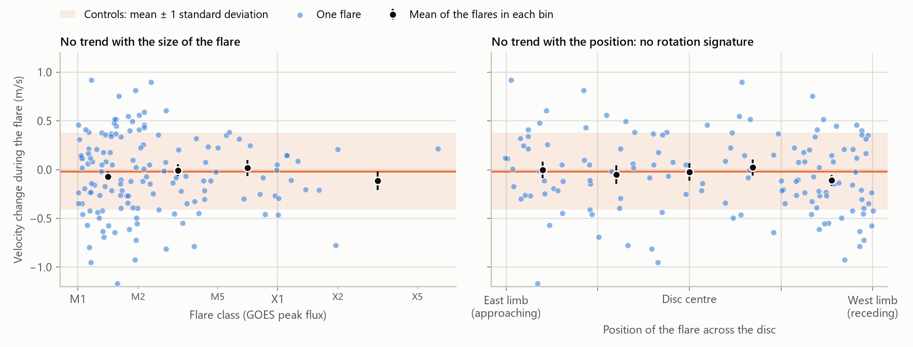

# Results

Status: November 2026. The velocity results are complete; the spectral results are
preliminary.

## The velocity of the Sun does not change during flares

With 139 M and X flares, the radial velocity of the Sun seen as a star does not change
detectably during a flare.

| Quantity | Value (m/s) | 95 % limit (m/s) |
|---|---|---|
| Mean change of an M or X flare | −0.035 ± 0.035 | 0.09 |
| Change per X1 flare (scaled with the flux) | −0.010 ± 0.061 | 0.11 |
| Rotation term per X1 flare at the equatorial limb | −0.106 ± 0.082 | 0.24 |

The limit on the mean change is of the order of the 0.09 m/s that the Earth imprints on the
Sun.

There is no trend with the size of the flare or with its position on the disc. Shuffling the
positions among the flares gives a rotation term this large 10 % of the time.

In physical terms the limit on the rotation term means K · ΔF / F < 1.2 × 10⁻⁴ per X1
flare, with ΔF / F the relative brightening in the visible and K the response of the line
mask (see [Method](method.md#three-estimates)).

## The result does not depend on the analysis choices

| Variant | Flares | Mean change | Per X1 | Rotation per X1 |
|---|---|---|---|---|
| Default | 139 | −0.035 ± 0.035 | −0.010 ± 0.061 | −0.106 ± 0.082 |
| Day polynomial of degree 1 | 137 | −0.022 ± 0.036 | −0.015 ± 0.060 | −0.045 ± 0.080 |
| Day polynomial of degree 3 | 139 | −0.001 ± 0.033 | +0.016 ± 0.049 | −0.079 ± 0.083 |
| Window: 3 min either side of the steepest X-ray rise | 120 | −0.009 ± 0.042 | −0.019 ± 0.061 | −0.108 ± 0.135 |
| Window: first 10 min from the start | 134 | −0.040 ± 0.035 | +0.006 ± 0.045 | −0.004 ± 0.080 |
| Window: 5 min either side of the X-ray peak | 126 | −0.021 ± 0.042 | −0.111 ± 0.085 | −0.134 ± 0.154 |
| Background: straight line fitted on both sides | 93 | −0.008 ± 0.040 | −0.032 ± 0.070 | −0.002 ± 0.113 |
| X-class flares only | 11 | −0.060 ± 0.088 | +0.011 ± 0.065 | −0.051 ± 0.104 |

All in m/s, with errors from the bootstrap over days. Same-day controls exist for 8 flares
and say nothing: +0.07 ± 0.17 m/s.

### Demonstrated sensitivity

| Injected signal | Recovered | Probability of detecting it at 95 % |
|---|---|---|
| 5 cm/s | 4.9 cm/s | 40 % |
| 10 cm/s | 9.8 cm/s | 88 % |
| 20 cm/s | 19.5 cm/s | 100 % |
| 50 cm/s | 48.8 cm/s | 100 % |

## Flares do not raise the amplitude of the solar oscillations

| Quantity | Flares | Null samples | 95 % limit on the excess |
|---|---|---|---|
| ln(power after / before) | −0.068 | 0.001 ± 0.053 | 0.16 |
| The same, weighting high frequencies | −0.013 | −0.009 ± 0.060 | 0.10 |

A mean increase above 8 % in amplitude is ruled out. This tests the proposal of Karoff and
Kjeldsen (2008), with the limitation that the 83 s cadence reaches only 6 mHz.

## The chromospheric lines do respond

!!! warning "Preliminary"
    Four flares, and no flare-free control windows for the spectra yet. The errors come from
    the scatter of the spectra before each flare and do not include slow drifts with the
    height of the Sun.

In the spectra of the strongest flares the chromospheric indices rise clearly when the flare
is on the disc, while the velocity of the same spectra stays flat.

Mean change from 8 minutes before the X-ray peak to 10 minutes after it, in parts per
thousand (velocity in m/s):

| Flare | Position | H alpha core | Ca II H and K | Ca II 8542 | Velocity |
|---|---|---|---|---|---|
| X6.3, 2024-02-22 | disc (r = 0.59) | +5.3 ± 0.5 | +6.9 ± 1.2 | +2.3 ± 0.6 | +1.0 ± 0.4 |
| X2.8, 2023-12-14 | disc (r = 0.76) | +1.57 ± 0.09 | +4.0 ± 1.4 | +1.7 ± 0.3 | −0.4 ± 0.2 |
| X8.6, 2024-05-14 | limb (r = 1.00) | +0.6 ± 0.6 | +1.1 ± 0.8 | +0.7 ± 0.5 | −0.3 ± 0.7 |
| X1.9, 2025-02-23 | near the limb (r = 0.96) | −1.4 ± 0.4 | +0.2 ± 0.8 | +0.4 ± 0.4 | +0.3 ± 0.6 |

- **On the disc, a clear detection.** H alpha rises by 0.6 to 0.8 parts per thousand per
  unit of X class.
- **At the limb, nothing.** The emission of the footpoints is hidden or strongly
  foreshortened.
- **The negative value of the X1.9 flare** may be a slow drift; without controls it cannot
  be told apart.

Three more flares already downloaded are lost to clouds or an unsteady sky.

## What is left

- More spectra: the rest of the strongest flares and their control windows, to measure how
  the chromospheric response scales with class and with position.
- Eruptive against confined flares, by cross-matching with a catalogue of coronal mass
  ejections.
- Grouping the flares by active region in the bootstrap.
